<p align="center"></p>

<h1 align="center">GoatMediaStackarr</h1>

<p align="center">A whole self-hosted media stack in <b>one container</b>, behind <b>one interface</b> and <b>one login</b>, with a <b>built-in VPN</b> for the download apps.</p>

<p align="center">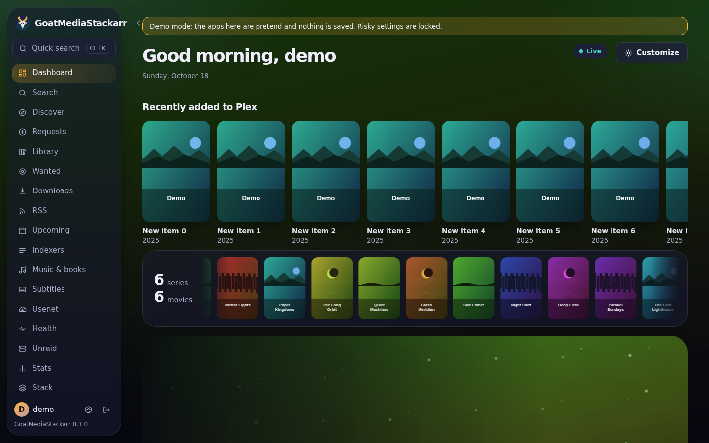</p>

---

Install one container and you get Sonarr, Radarr, Lidarr, Prowlarr, Bazarr, qBittorrent, SABnzbd, Jellyfin, Seerr and (optionally) Plex and Tautulli, already set up and connected to each other. You don't install, configure or link the separate apps.

> **Status: early (0.1).** This first stage is the container foundation: every engine bundled, wired together automatically, the VPN with its kill switch, and the interface (built from [MediaHub](https://github.com/bdlnaredi/mediahub)) with the built-in apps added for you. A setup wizard, a VPN badge and a usenet-server screen come next.

## Screenshots

| | |
|---|---|
|  | 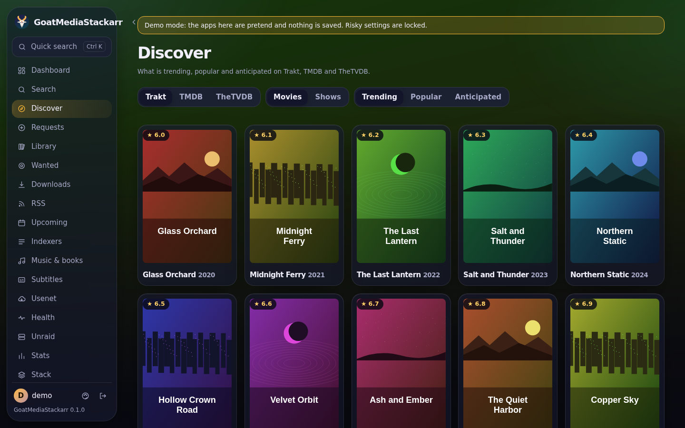 |
| **Dashboard**: every app's status, what's downloading and what's new | **Discover**: trending and popular titles to request |
| 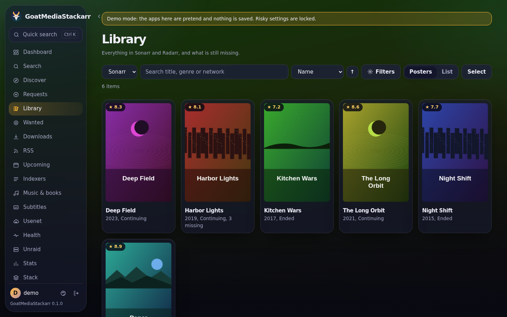 | 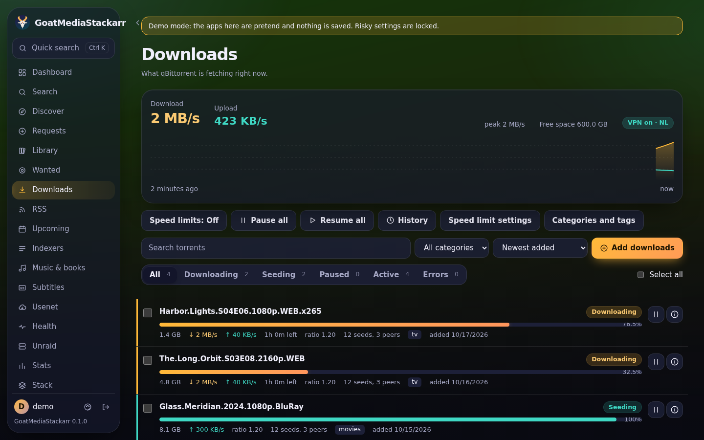 |
| **Library**: your shows, movies and music | **Downloads**: torrents and usenet in one list |
| 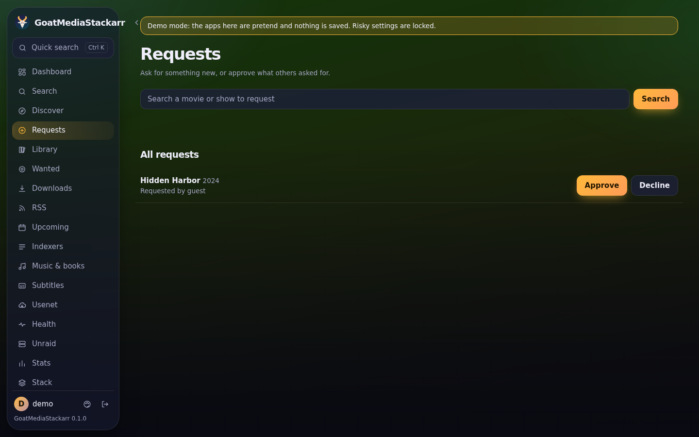 | 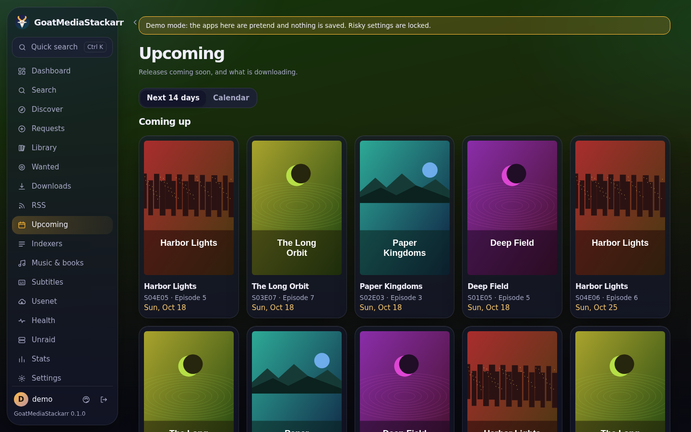 |
| **Requests**: approve what others ask for | **Upcoming**: release calendar |
| 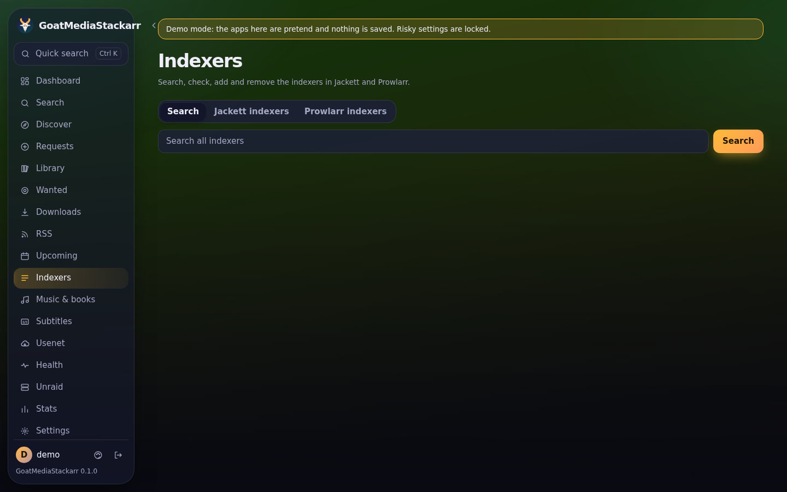 | 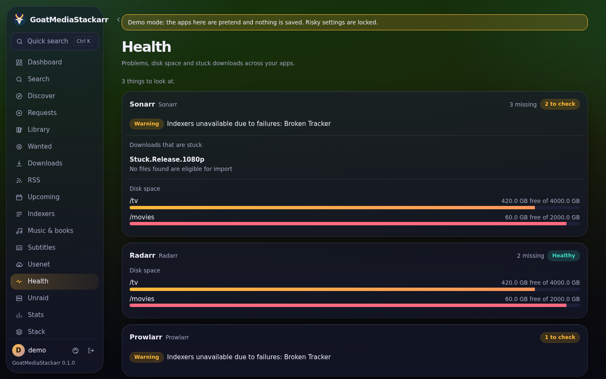 |
| **Indexers**: add and test Prowlarr sites | **Health**: problems that need attention |
| 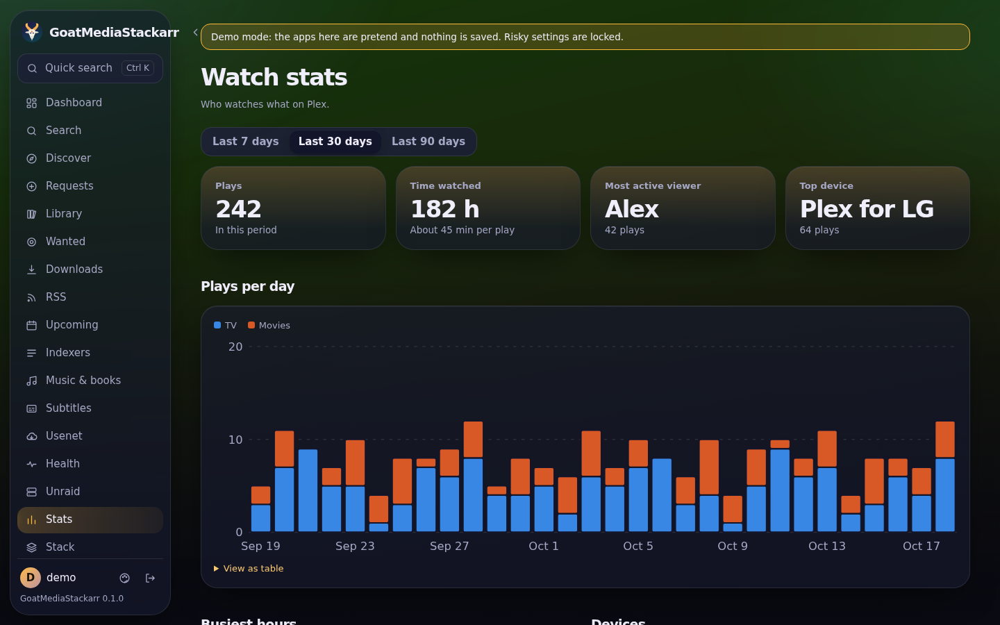 | 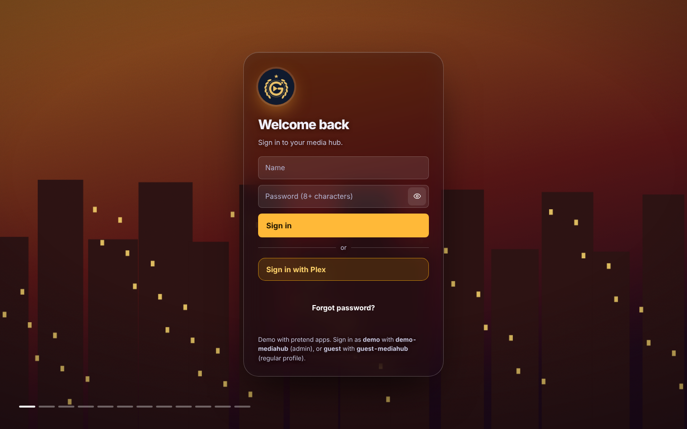 |
| **Stats**: what's been watched and downloaded | **Sign in** |

<p align="center">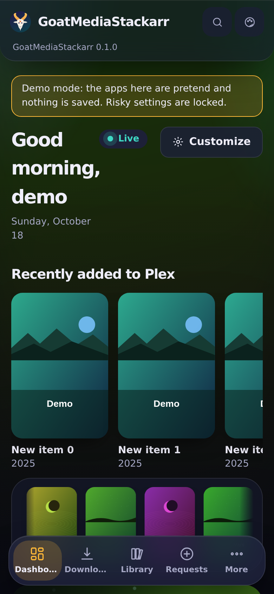</p>

Screenshots are taken in demo mode with pretend apps. To refresh them after interface changes, run **Update screenshots** from the repository's Actions tab.

## What happens when you install it

1. **One container** appears on your Unraid Docker page.
2. **First start**: every engine gets its own API key and is connected to the others:
   - Sonarr (TV), Radarr (movies) and Lidarr (music) get their library folders, plus qBittorrent and SABnzbd as download clients
   - Prowlarr sends its indexers to Sonarr, Radarr and Lidarr
   - Bazarr fetches subtitles for Sonarr and Radarr
   - Jellyfin is set up with Movies, TV Shows and Music libraries
   - Seerr signs in through Jellyfin and sends requests to Sonarr and Radarr
3. **Open `http://YOUR-SERVER:2806`** and create your admin account. All the built-in apps are already listed.
4. **Add indexers** in Prowlarr (from the indexer screen, or Advanced → Prowlarr), and your usenet server in SABnzbd if you use usenet.

The engines listen only inside the container. The only ways in are GoatMediaStackarr (port 2806) and Jellyfin (port 8096, for TV and phone apps).

## Install on Unraid

Use the template in [`unraid/goatmediastackarr.xml`](unraid/goatmediastackarr.xml), or add a container with:

| Setting | Value |
|---|---|
| Repository | `ghcr.io/bdlnaredi/goatmediastackarr:latest` |
| Port 2806 | GoatMediaStackarr |
| Port 8096 | Jellyfin |
| Port 32400 | Plex, only if turned on |
| `/config` | `/mnt/user/appdata/goatmediastackarr` (every app's settings; back this up) |
| `/media` | `/mnt/user/media` (your library) |
| `/downloads` | `/mnt/user/downloads` (torrent and usenet downloads) |
| Extra parameters | `--cap-add=NET_ADMIN --device=/dev/net/tun --sysctl net.ipv4.conf.all.src_valid_mark=1 --sysctl net.ipv4.conf.all.rp_filter=2` |

Other systems: see [`docker-compose.yml`](docker-compose.yml).

### Folders

By default the library and the downloads are two separate folders:

```
/media/tv               TV shows (Sonarr, Jellyfin "TV Shows")
/media/movies           Movies (Radarr, Jellyfin "Movies")
/media/music            Music (Lidarr, Jellyfin "Music")
/downloads/torrents     qBittorrent (incomplete and complete)
/downloads/usenet       SABnzbd (incomplete and complete)
```

**Both inside one folder.** If you prefer one share for everything, map a single folder and point both settings inside it:

| Setting | Value |
|---|---|
| `/data` | `/mnt/user/data` |
| `MEDIA_DIR` | `/data/media` |
| `DOWNLOADS_DIR` | `/data/downloads` |

This has one advantage: finished downloads are moved into the library instantly (hardlinked) instead of copied. With two separate mappings they are copied, which is slower and briefly uses double the space, even when both folders are on the same disk.

Existing files in your media and downloads folders are never re-owned or moved.

## The VPN

Only the apps that need it use the VPN. By default those are qBittorrent, SABnzbd and Prowlarr. Jellyfin streaming, Seerr, Sonarr, Radarr and the interface keep using your normal internet.

1. Set **VPN on** (`VPN_ENABLED`) to `true`.
2. Download a WireGuard `.conf` (or OpenVPN `.ovpn`) file from your VPN provider and put it in `appdata/goatmediastackarr/vpn/`.
3. For OpenVPN, set **VPN type** to `openvpn`, plus **VPN username** and **VPN password** if your provider uses them.

**Kill switch.** The VPN apps are blocked from the internet before they even start, and they stay blocked whenever the tunnel is down. They never fall back to your home connection. They can still talk to the other apps inside the container, so Sonarr can always tell qBittorrent what to download.

**DNS** for the VPN apps goes through the tunnel too, which also gets around ISP blocks on indexer sites.

**Port forwarding.** For ProtonVPN and other NAT-PMP providers, set `VPN_PORT_FORWARD=natpmp`. The forwarded port is set in qBittorrent automatically.

| Variable | Default | Meaning |
|---|---|---|
| `VPN_ENABLED` | `false` | Turn the VPN on |
| `VPN_TYPE` | `wireguard` | `wireguard` or `openvpn` |
| `VPN_USER`, `VPN_PASS` | | OpenVPN sign-in, if needed |
| `VPN_APPS` | `qbittorrent,sabnzbd,prowlarr` | Which apps use the VPN |
| `VPN_DNS` | from the VPN file | DNS server used through the tunnel |
| `VPN_PORT_FORWARD` | `off` | `natpmp` for ProtonVPN-style port forwarding |
| `VPN_PF_GATEWAY` | `10.2.0.1` | NAT-PMP gateway inside the tunnel |

Unraid 7 includes WireGuard. If your server's kernel does not, use an OpenVPN file instead.

## Advanced: each app's own page

Admins can open any engine's original page through GoatMediaStackarr, signed in with their GoatMediaStackarr account:

`/engines/sonarr/`, `/engines/radarr/`, `/engines/lidarr/`, `/engines/prowlarr/`, `/engines/bazarr/`, `/engines/qbittorrent/`, `/engines/sabnzbd/`, `/engines/tautulli/`

Jellyfin is at port 8096. Its admin user is `goat-admin`; the password is `jellyfinPass` in `appdata/goatmediastackarr/goat/secrets.json`. Change it in Jellyfin if you like.

## Choosing apps

`GOAT_ENGINES` lists the apps to run. Remove any you don't want.

- Add `plex` for a built-in Plex server (see below).
- Add `tautulli` for Plex statistics. Tautulli only works with Plex.

## Plex

There are two ways to use Plex. You can also use both Plex and Jellyfin together on the same media folders.

**Your existing Plex server.** Add it in Settings → Apps with its address and token, as with any other app. Nothing else changes.

**Built-in Plex** (off by default):

1. Add `plex` to `GOAT_ENGINES` and map port 32400.
2. Get a claim code from [plex.tv/claim](https://plex.tv/claim), put it in `PLEX_CLAIM`, and start the container within 4 minutes. This links the new server to your Plex account. It's only needed once.
3. GoatMediaStackarr then creates Movies, TV Shows and Music libraries on your media folders. If Tautulli is turned on, it is connected to Plex automatically.

Plex is free to use but not open source. So it isn't shipped inside this image. It is downloaded from plex.tv on first start, the same way the official Plex container does it. `PLEX_UPDATE=false` keeps the installed version. Hardware transcoding needs Plex Pass, as usual.

**Seerr** works with one media server. It uses Jellyfin when Jellyfin runs, otherwise Plex. Set `SEERR_MEDIA_SERVER=plex` to use Plex while both run. This choice is made on Seerr's first setup.

## Other settings

| Variable | Default | Meaning |
|---|---|---|
| `PUID` / `PGID` | `99` / `100` | User and group that own the files (Unraid's nobody/users) |
| `TZ` | `Etc/UTC` | Time zone |
| `UMASK` | `002` | New files are group-writable |

## Where things are kept

`appdata/goatmediastackarr/`:

- `<app>/`: each engine's own settings and database
- `goat/secrets.json`: the keys and passwords made on first start
- `goat/wired.json`: what was connected on the last start, and any errors
- `ui/`: GoatMediaStackarr accounts and settings
- `vpn/`: your VPN file

If a connection fails on first start (for example an engine was slow), it is retried at the next container start. Settings you change inside an engine are kept; only the addresses and keys GoatMediaStackarr manages are rewritten.

## Bundled software and licenses

GoatMediaStackarr is GPL-3.0-or-later. It runs the official releases of each engine unchanged. They keep their own licenses: see [THIRD_PARTY.md](THIRD_PARTY.md). The names Sonarr, Radarr, Jellyfin and the others belong to their projects. GoatMediaStackarr is not affiliated with or endorsed by them.

## Development

```
npm test                         # settings, wiring (against fake engines) and the interface
sudo bash test/vpn-killswitch.sh # the kill switch for real, in Linux network namespaces
```

CI also builds the image, starts it, and checks that every engine answers and is connected.

The logo is drawn by `docs/logo/make_logo.py`, which also writes the app icons in `ui/public`.
