<p align="center"></p>

<h1 align="center">GoatMediaStackarr</h1>

<p align="center"><b>Your whole media server in one container.</b><br>
Sonarr, Radarr, Lidarr, Prowlarr, Bazarr, qBittorrent, SABnzbd, Jellyfin and Seerr, already set up and talking to each other,<br>
behind one web page, one Android app and one login, with a VPN and kill switch for the download apps.</p>

<p align="center">
<a href="https://github.com/bdlnaredi/goatmediastackarr/releases/latest"></a>
<a href="https://github.com/bdlnaredi/goatmediastackarr/actions/workflows/ci.yml"></a>


</p>

<p align="center">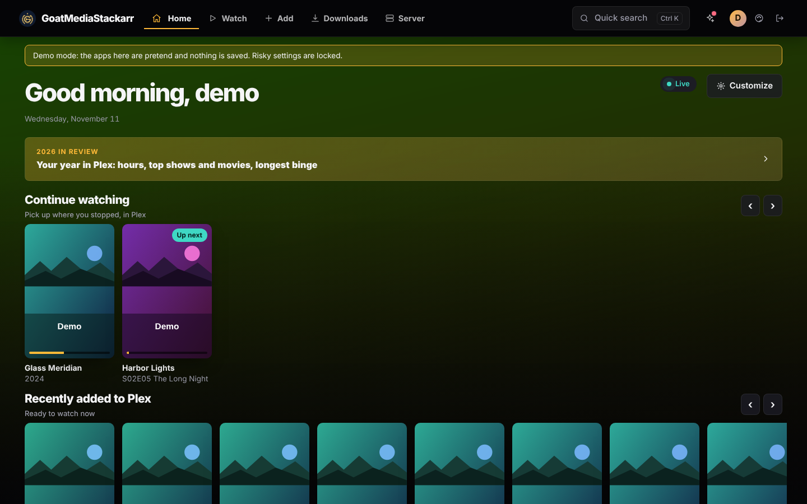</p>

<p align="center">
<a href="#install-on-unraid">Install</a> ·
<a href="#a-tour">Tour</a> ·
<a href="#for-the-people-who-use-it">Your people</a> ·
<a href="#on-your-phone-and-tv">Phone &amp; TV</a> ·
<a href="#the-vpn">VPN</a> ·
<a href="#switch-on-more-apps">More apps</a> ·
<a href="#troubleshooting">Troubleshooting</a>
</p>

---

## Why this exists

Running a media server usually means a dozen containers, a dozen web pages, a dozen passwords, and an evening of copying API keys from one app into another. Then a VPN container that the download apps have to be routed through. Then a request app for the family. Then another app for your phone. Then one day an update breaks a connection, and you go looking through twelve logs.

**GoatMediaStackarr is all of that in one container.** On its first start it gives every app its own keys and passwords, connects every app to the ones it needs, and opens one web page where you sign in once. From there you watch what's new, ask for shows and movies, follow downloads and look after the server. The same things are in a native Android app.

| On by default | Turn on when you want it | Bring your own |
|---|---|---|
| Sonarr (TV) · Radarr (movies) · Lidarr (music) · Prowlarr (indexers) · Bazarr (subtitles) · qBittorrent · SABnzbd (usenet) · Jellyfin · Seerr (requests) · File Browser | Plex · Tautulli · FlareSolverr · ruTorrent (with rTorrent) · Deluge · cross-seed · autobrr · Unpackerr | Any of these you already run, plus Readarr, Jackett, Unraid itself and an existing Plex |

- **Already connected.** Library folders and download clients in Sonarr, Radarr and Lidarr. Prowlarr sends its indexers to all three. Bazarr works with Sonarr and Radarr. Jellyfin gets Movies, TV Shows and Music libraries. Seerr signs in through Jellyfin or Plex and sends requests to Sonarr and Radarr.
- **Kept connected.** Every start checks the connections again, so a restored backup with an old API key just works.
- **Private by default.** The apps listen only inside the container. You reach them through GoatMediaStackarr, signed in.
- **Intel/AMD and ARM.** One image name for both, rebuilt every week with the newest release of every app, and published only when every check passes.

> **Version 1.0.** Everything here is tested on every change, inside the real image on both kinds of processor. The web page grew out of [MediaHub](https://github.com/bdlnaredi/mediahub). Try it before you trust it with a library you can't replace, and keep backups (it can make them for you).

---

## Install on Unraid

Five steps, about ten minutes, most of it waiting.

1. **Add the container.** Use the template in [`unraid/goatmediastackarr.xml`](unraid/goatmediastackarr.xml) (the [MediaHub](https://github.com/bdlnaredi/mediahub) repository carries the same one), or add a container by hand:

   | Setting | Value |
   |---|---|
   | Repository | `ghcr.io/bdlnaredi/goatmediastackarr:latest` |
   | `/config` | `/mnt/user/appdata/goatmediastackarr` (every app's settings: back this up) |
   | `/media` | `/mnt/user/media` (your library) |
   | `/downloads` | `/mnt/user/downloads` (torrents and usenet) |
   | Ports | `2806` GoatMediaStackarr · `8096` Jellyfin · `5055` Seerr · and only if turned on: `32400` Plex, `8090` ruTorrent, `8112` Deluge |
   | Extra parameters | `--cap-add=NET_ADMIN --device=/dev/net/tun --sysctl net.ipv4.conf.all.src_valid_mark=1 --sysctl net.ipv4.conf.all.rp_filter=2` |

   Not on Unraid? Use [`docker-compose.yml`](docker-compose.yml).
2. **Start it** and give it a few minutes: the first start sets up and connects every app.
3. **Open `http://YOUR-SERVER:2806`** and make your admin account. You land on the **Stack** page and its setup checklist.
4. **Add indexers** (the Indexers page, or Prowlarr's own page), and your news server under **Usenet** if you use usenet.
5. **Turn on the VPN** if you want one (see [The VPN](#the-vpn)).

<p align="center">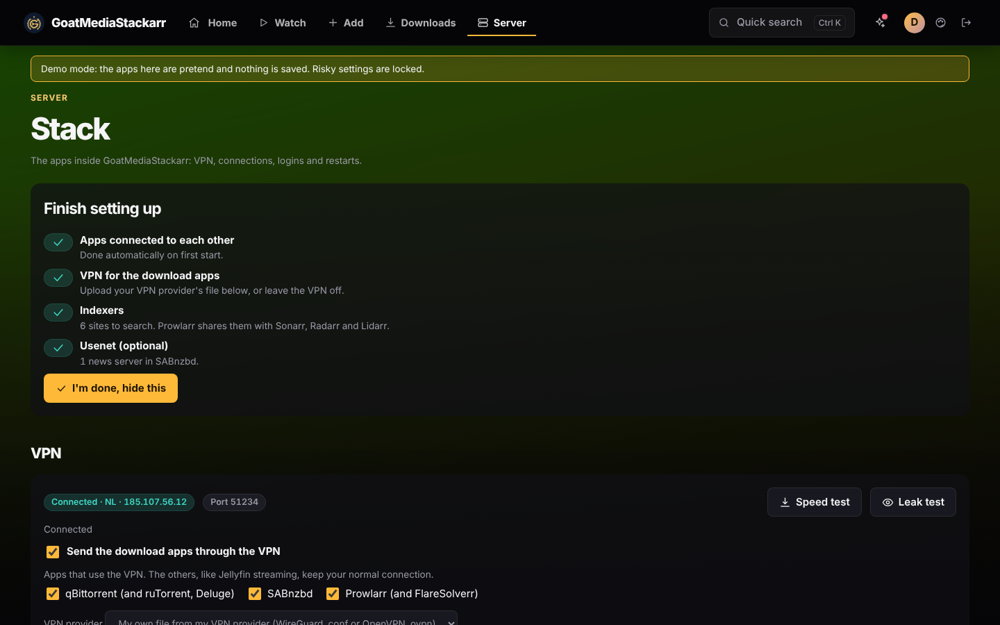</p>

Keep App data on a cache drive or SSD with room to grow. The image is about 2.5 GB; Jellyfin won't start with less than 2 GB free in App data, and FlareSolverr needs about 1.5 GB when it is turned on.

---

## A tour

### Pick a look

Four complete designs, not four colour schemes: shapes, spacing, surfaces, how much artwork shows and, on a computer, even where the menu sits. Each works in light and dark with every accent colour. **Appearance → Style** on the web page, **Settings → Style** in the app.

| | |
|---|---|
|  | 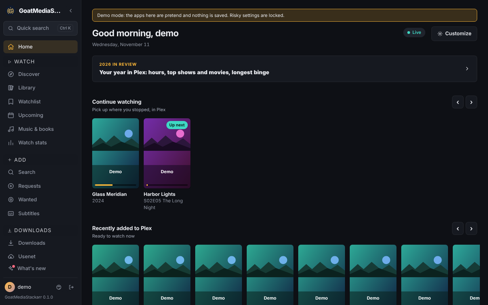 |
| **Cinema** (the default): dark and poster-first like a streaming app, with the menu as a bar across the top | **Dashboard**: clean cards and clear lists, information first |
| 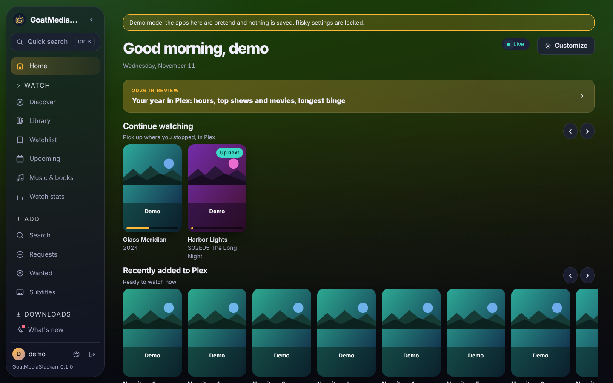 | 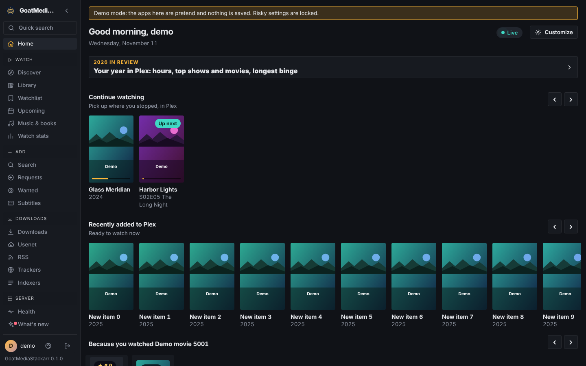 |
| **Glass**: frosted panels floating over your artwork | **Compact**: flat and tight, more on every screen, light on older devices |

<p align="center">
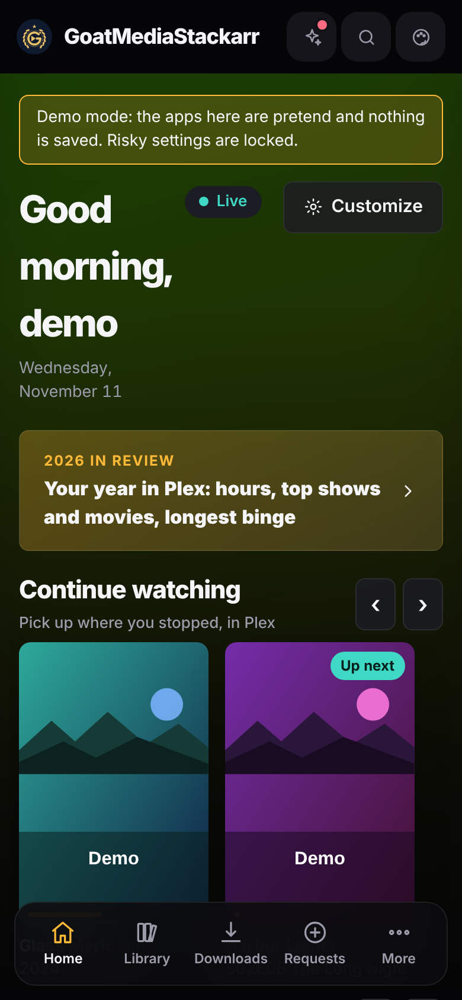
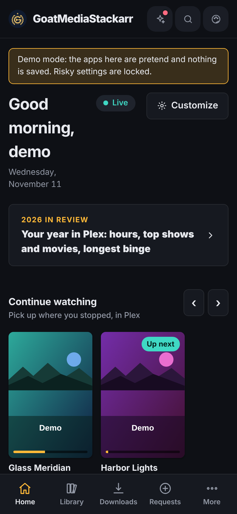
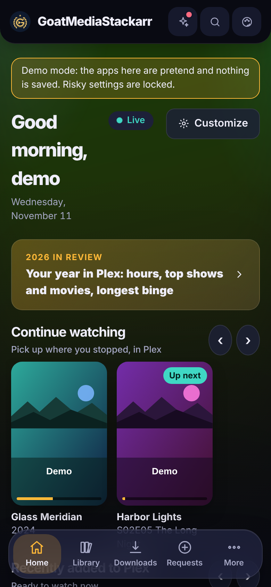
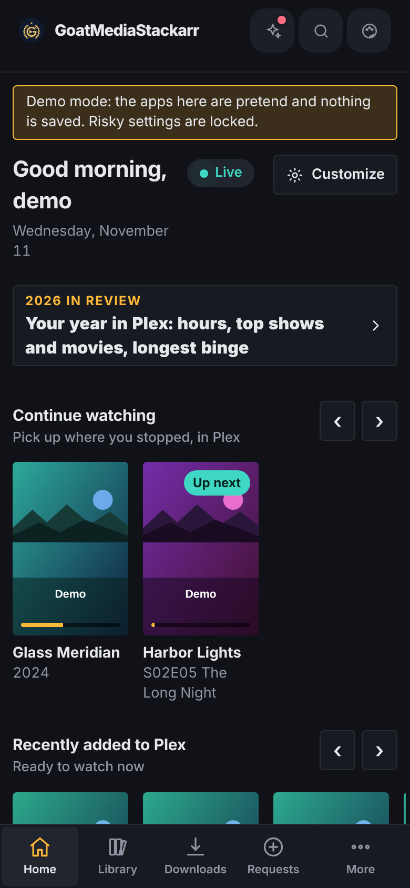
</p>

It works on a phone as well as a computer. Every page has its own address (`/downloads`, `/library`, `/settings/alerts`…), so bookmarks, links and the Back button work, and a pop-up counts as a step back. **Ctrl K** (or `/`) opens quick search for pages, downloads, requests and the library. The menu has four groups: drop-downs across the top in Cinema, a side menu in the others, and on a phone a bottom bar with **More** for the rest.

<p align="center">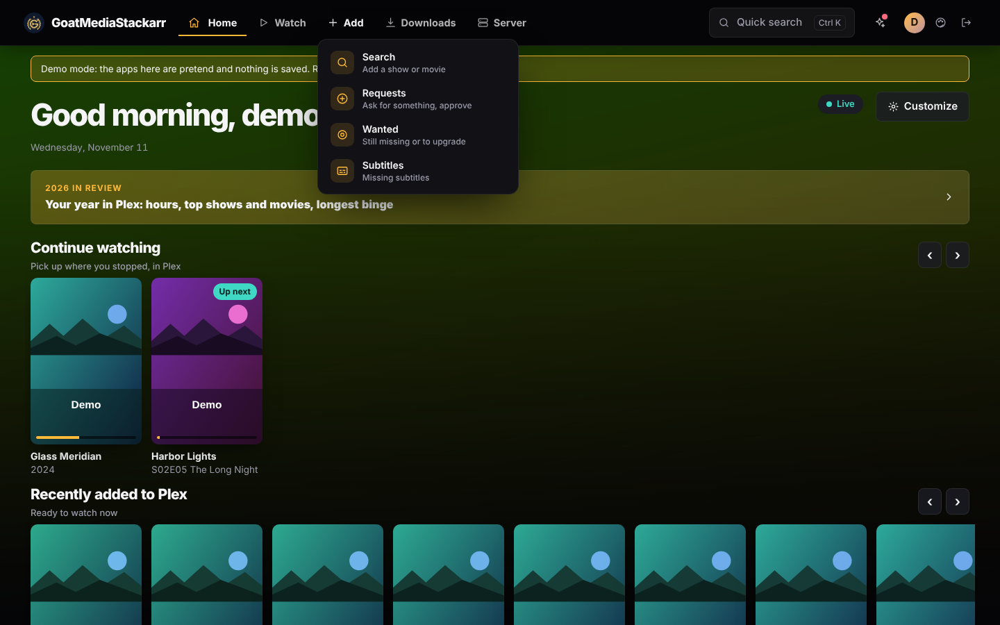</p>

### Find something to watch

The dashboard is the front door: what's playing and who is watching, download and upload speed, the server's health and what needs you. Below that, a drifting poster wall of your library, featured titles, *Continue watching* from Plex or Jellyfin, *Recently added to Plex* (ready now), *Recently added to Radarr and Sonarr* (maybe still downloading), top rated and coming up. **Customize** chooses what it shows and in which order.

| | |
|---|---|
| 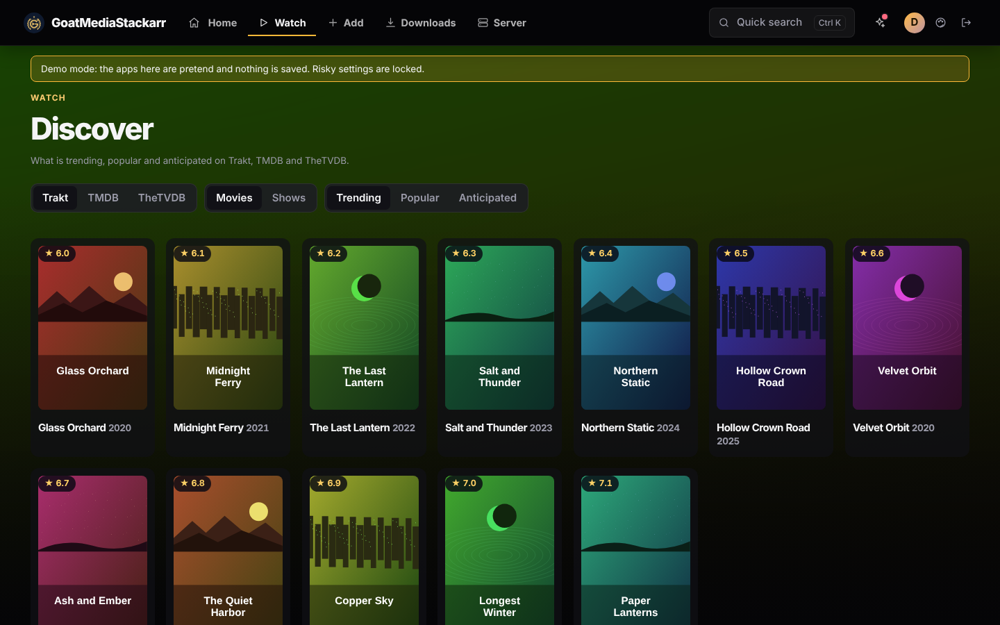 | 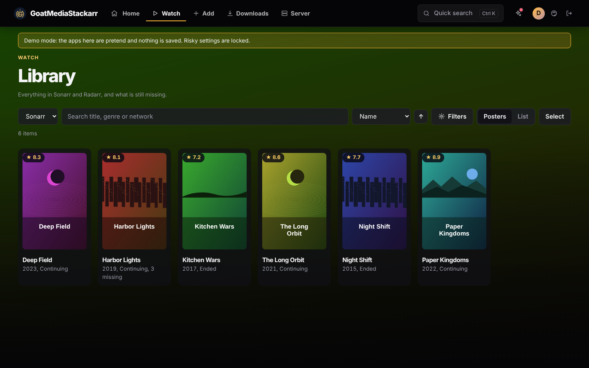 |
| 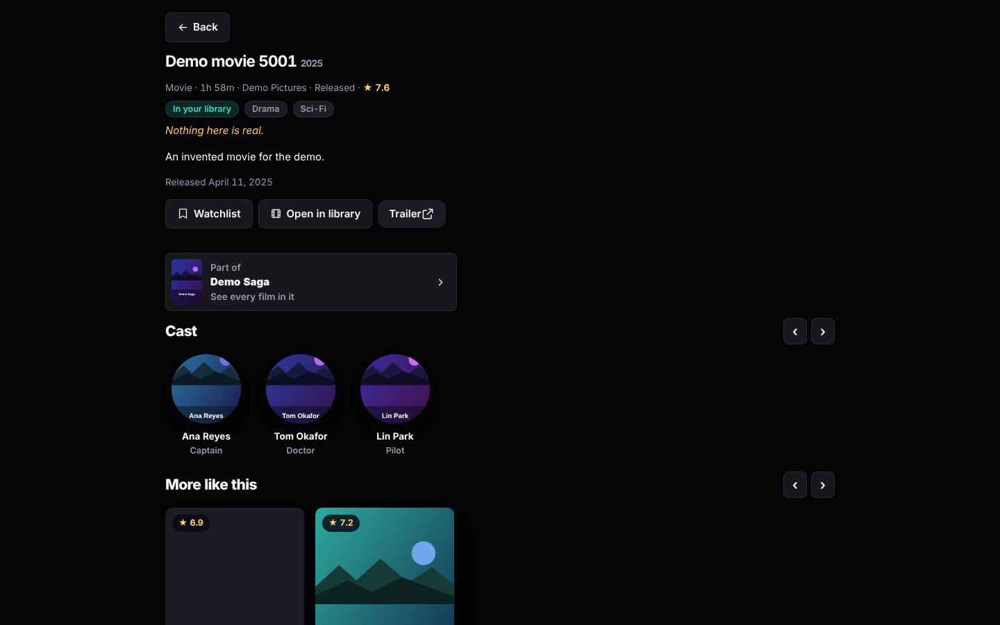 | 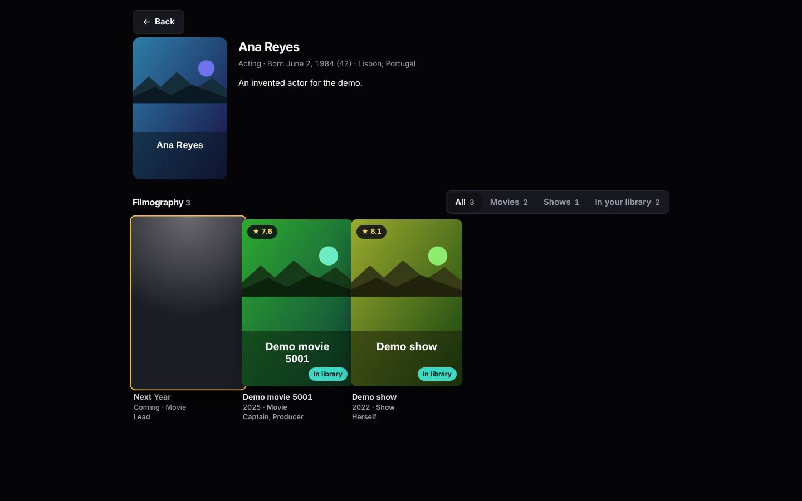 |

- **Discover** and **Search**: what's trending, popular and coming on TMDB, Trakt and TheTVDB, and a search across Sonarr and Radarr.
- **Library**: your shows and movies, as posters or a list, with filters. A show's page has its seasons and episodes (each with its story), monitoring, search and **Choose a release** (pick a release yourself from what your indexers have).
- **Every title has its own page**: story, cast, seasons, trailer, whether it's in your library, and **More like this**. Tap an actor for everything they were in, filterable to movies, shows or what you already have.
- **Watchlist**: everyone keeps their own list from any title's page. It shows which are here, on their way or not asked for yet, and each person hears when theirs lands. Admins can have watchlist titles asked for automatically.
- **Collections** and **Because you watched**: a movie's page names its collection, the collection's page lists every film with *Request the missing ones*, Radarr's collections are under Library, and the dashboard suggests titles from what each person actually watched.
- **Missing episodes**: a show's page lists the episodes that aren't here, and each can be asked for on its own.
- **Upcoming**: the next two weeks, or a month calendar. Anything already downloaded in the quality it should be is left out; one still waiting for a better copy stays.
- **Trakt and Letterboxd** (Settings → Account): connect your own Trakt and your watchlist stays the same in both places, and what you finish in Plex goes to your Trakt history. A public Letterboxd watchlist can be brought in too.
- **Music & books**: Lidarr's artists and Readarr's authors.

<p align="center">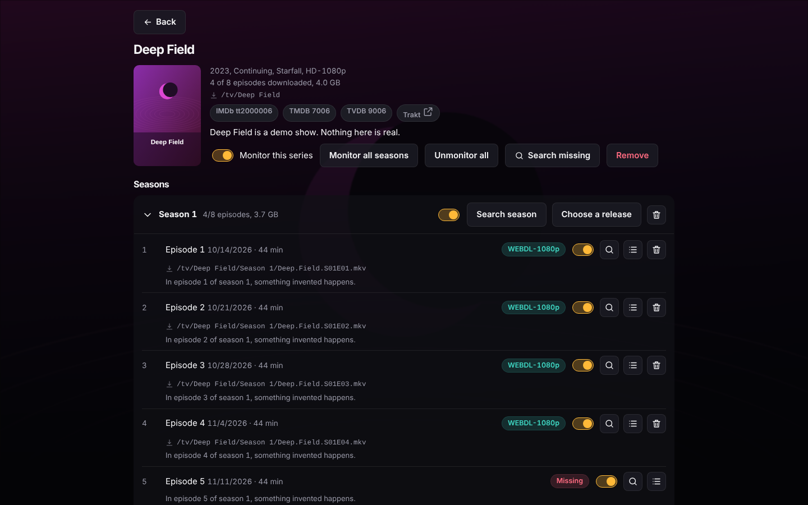 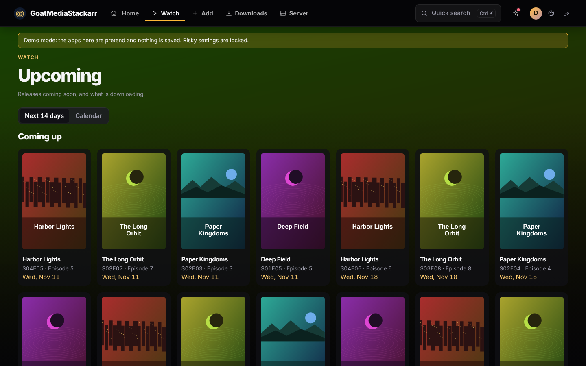</p>

### Ask for it, and follow it all the way

Anyone can ask for a show or movie. Admins approve or decline, or let a profile approve itself. A request doesn't just say "pending": it shows where it really is, from *Requested* and *Approved* through *Looking for a download*, *Downloading* (how far, how long), *Copying to the library* and *In the library* to *Available*.

<p align="center">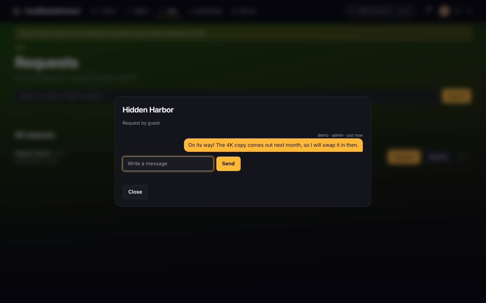</p>

- **Talk about it.** Each request has a conversation: the person who asked and the admins write back and forth ("can you get the 4K one?"), and each side is told.
- **Know before you ask.** A request shows about how big it will be and whether it needs an admin. **Request rules** (Settings → Limits) approve the ones that fit by themselves: by kind, rating, size and person. Request limits per person.
- **Report a problem** with any title in the library (won't play, wrong language, bad copy). The admins are told and can write back.
- **Subtitles**: on a title's page, the subtitles Bazarr has and the languages it wants, with **Find subtitles**.
- **Wanted**: what Sonarr and Radarr are still looking for, with **Choose a release** on each.

### Downloads, in one place

qBittorrent, ruTorrent, Deluge and SABnzbd in one list: pause, resume, remove, categories and tags, files, trackers, peers, speed limits and schedules, and adding links or `.torrent` files. Sort by speed, time left, progress, seeders, ratio, size or name.

- **Speed limits per category** (Downloads → Speed limit settings): a download and upload limit for all of a category's torrents together, say 2 MB/s for `movies` so TV episodes still come in fast. It is shared among the category's torrents that are moving data and checked every minute; take it off and their own limits go too.

| | |
|---|---|
| 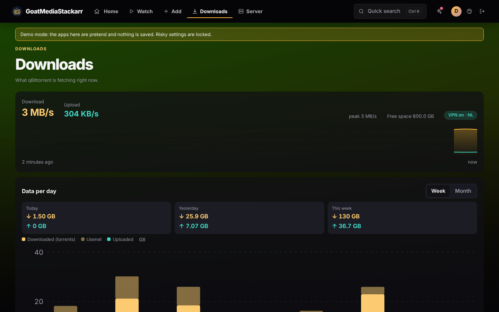 | 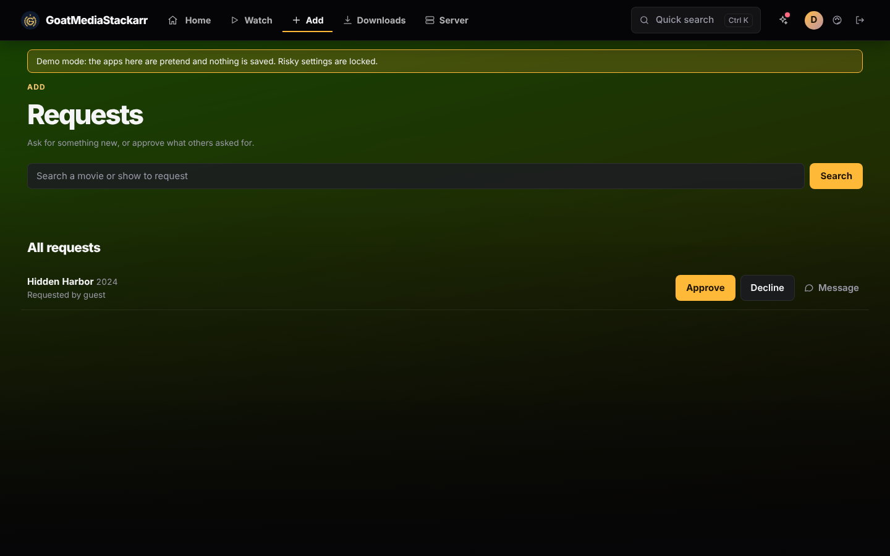 |
| 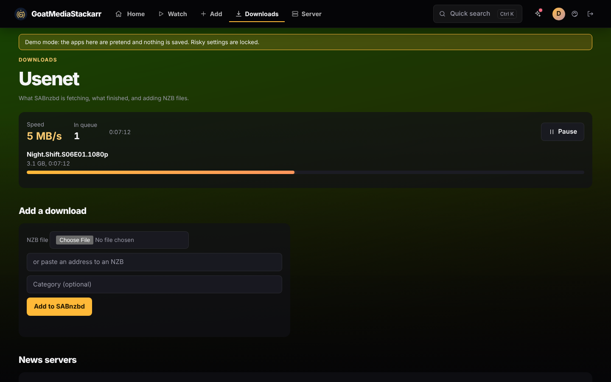 | 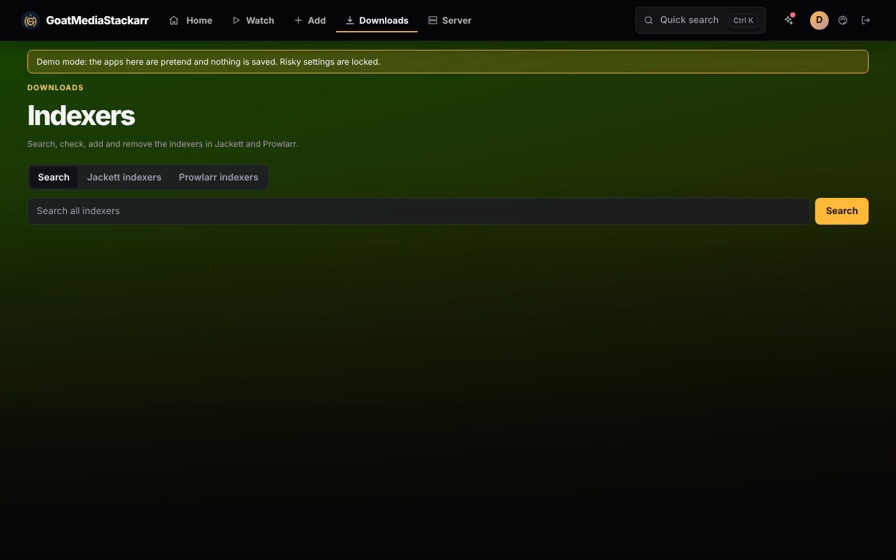 |

- **Import finished downloads** (Settings → Download rules): a torrent Sonarr and Radarr didn't grab themselves (from Trackers, RSS or added by hand) is imported when it finishes and every file is a clear match. The rest wait on that page: **Import** to say what it is, or **Don't import** to take it off the list (or all of them at once). One you remove from Downloads leaves the list by itself.
- **Replace cam copies** (Settings → Download rules, off until you turn it on): a movie you only have as a cam, telesync or telecine copy has that file deleted a day (or as many as you choose) before it comes out digitally or on Blu-ray, and Radarr searches for a proper copy, so the good one arrives on release day. Everyone who can watch is told in a few words why it is gone for now. The page lists every such copy and when it goes; movies without a release date are kept.

  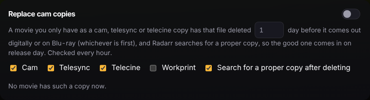
- **RSS**: qBittorrent's feeds and auto-download rules, and how often the feeds are checked.
- **Usenet**: SABnzbd's queue and history, and your provider's news servers (add, test, change, remove).
- **Trackers** (admins): search all your Prowlarr trackers at once (or one on its own) and send a result to qBittorrent; or browse a tracker's own website inside GoatMediaStackarr, through the VPN or not, signed in once, with every download or magnet button going straight to qBittorrent.
- **Indexers**: search, test and remove the sites in Prowlarr and Jackett. **Subtitles**: what Bazarr is still missing.

### When something breaks

Something always breaks eventually: a tracker goes down, an import fails, a disk fills up. GoatMediaStackarr is built to tell you first, show you why, and fix what it can by itself.

<p align="center">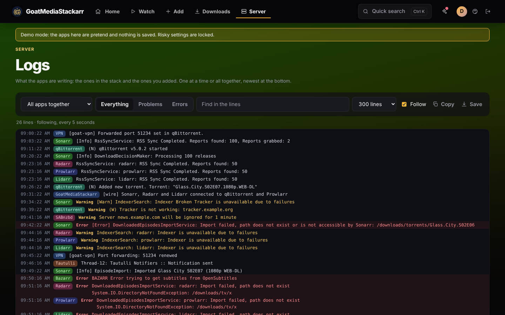</p>

- **Logs** (admins): what every app is writing, one at a time or **all together in time order**, newest at the bottom. Show only problems or errors, find a word, follow new lines as they come, copy or save them. The apps of the stack (and the VPN and GoatMediaStackarr itself) each keep their own log in `/config/logs/<app>/`, about 3 MB each; apps you added are read through their own API (Sonarr, Radarr, Lidarr, Readarr, Prowlarr, qBittorrent, SABnzbd, Bazarr, Tautulli, Seerr). Each app on the Stack page has a *Logs* button too.
- **Alerts from the logs**: admins are told when an app **keeps writing errors** (5 in 15 minutes unless changed under Alerts).
- **Health**: problems the apps report, stuck downloads, and disk space per folder, with a **forecast** of when each disk fills up at the rate of the last two weeks (and a small chart). **Fix problems by itself** (on by default) removes, blocks and searches again for downloads that failed or haven't moved for a day, and restarts a built-in app that stops answering. Every fix is listed there.
- **Alerts** to email, ntfy, Discord, Telegram, Pushover, Gotify or any webhook, each with its own list of what it hears about: a disk filling up within two weeks, an app down, a newer app version out, a VPN that dropped, a parity check that ended.

<p align="center">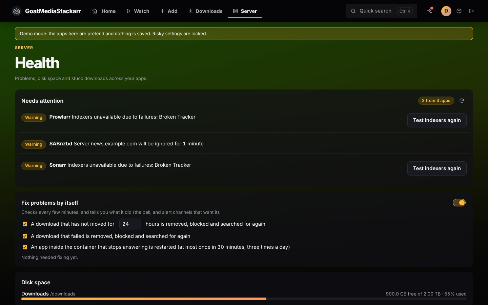</p>

### Run the server

- **Stack** (admins): everything about the container. The VPN (on or off, PIA with a region list or your provider's file, which apps use it, port forwarding, a leak test). Every app's health and version with **Restart**, **Stop**, **Start** and its own page. What changed after an update, and **App updates**: which apps have a newer release out, with what it changed, checked twice a day. **Logins made for you** (Jellyfin, qBittorrent, ruTorrent, Deluge) with **Change** to set your own password, which Sonarr, Radarr, Lidarr and Prowlarr are given too. The outside addresses for the Open buttons, linking Plex, and the connections, with a button to run them again.
- **File Browser** (admins): the media and downloads folders in the browser, opened from the Stack page: upload, download, rename, move and delete files.
- **Unraid**: the array, disks and containers, if you add your Unraid server.
- **Backups of the whole stack** (Settings → Backup): every app's settings and databases in one file, daily or weekly, and a guided *Put back* that restores only the apps you pick (with a copy of how they were just before).
- **Settings**: *Account* (password, two-step sign-in, passkeys, Sign in with Plex, devices, notifications on this device), *Appearance*, *Apps*, *Discover lists*, *Users*, *Limits*, *Status page*, *Alerts*, *Download rules*, *Backup* and *Activity*.

| | |
|---|---|
| 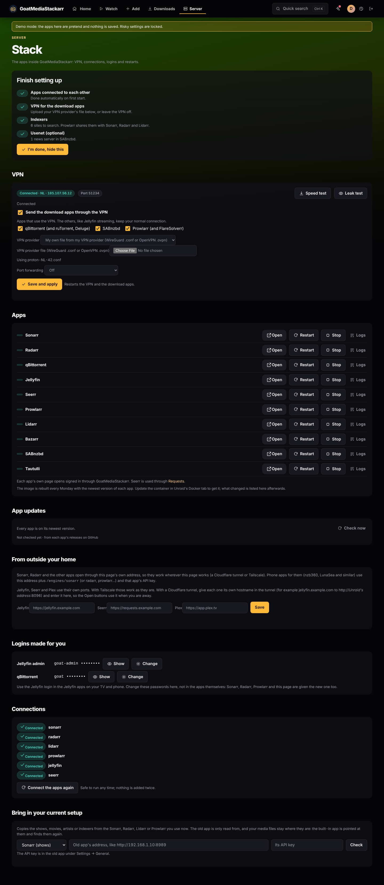 | 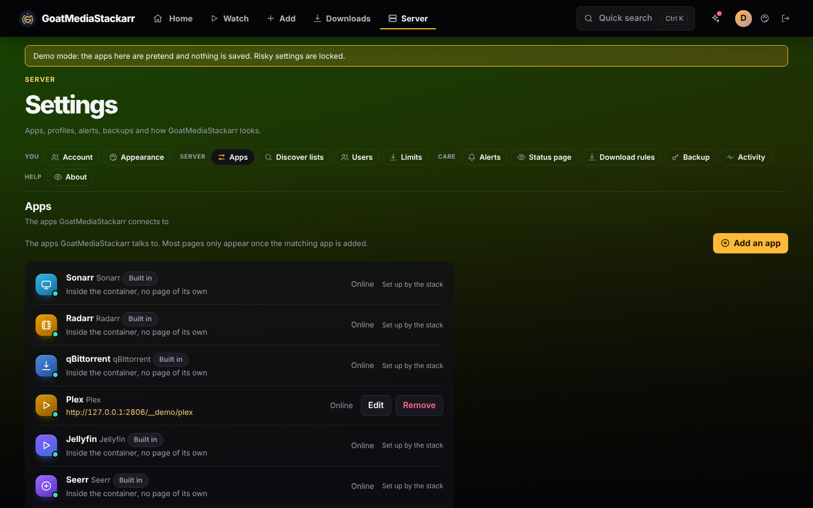 |

---

## For the people who use it

A media server is usually for more than one person. GoatMediaStackarr treats them as people, not as an afterthought.

- **Invite links** (Settings → Users): a link or QR code that lets people make their own profile, with the apps and rights you choose, for a day, a week, a month or until you remove it. An invite can also share your Plex libraries with their Plex account, make them a Jellyfin account, and greet them with a welcome note and a short how-to the first time they sign in.
- **Profiles that fit**: choose what each person can see and do. **Kids profiles** get a simpler look with only what's in the library and rated for their age, and no searching or requesting.
- **Limits**: everyone may stream 100 GB a month from Plex and Jellyfin by default (admins are never limited). At 80% they get a message, and at the limit their streams stop until the 1st. Change the default, count only streams from outside the home, or give someone their own limit under Settings → Limits. Admins can also cap the disk space a person's requests take.
- **Their own stats**: **Stats** shows what gets watched, from Tautulli. Admins see everyone; anyone else sees their own viewing, plus the server's most watched titles and most active viewers counted only in the libraries they can open, never with a title hidden from them (hidden labels, tags, genres or ratings, Plex's own limits, kids profiles).
- **Year in review**: each person's year in Plex (hours, top shows and movies, busiest day), from Tautulli, on the dashboard from November to January, and as an email if you want. Only admins can look at anyone else's year or the whole server's, and titles hidden from someone are left out of theirs.

  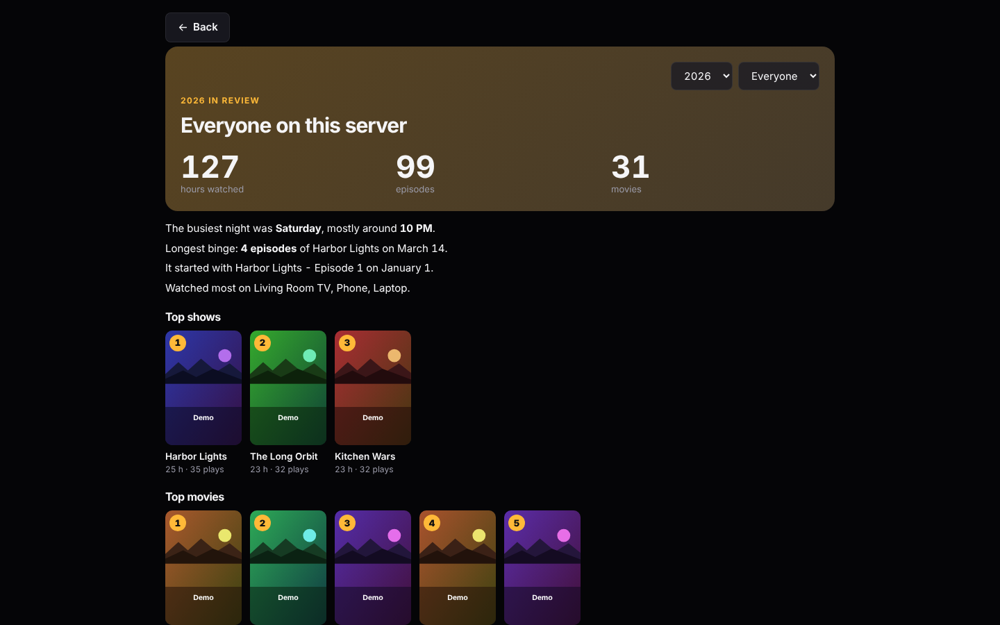
- **Weekly email for everyone** (Settings → Alerts): each person with an email address gets their own week: their requests and watchlist titles that came in, what's new and what's coming.
- **A status page for friends** (Settings → Status page, off until you turn it on): a page anyone can open at `/status` without signing in, to see whether Plex (or Jellyfin), Requests and new downloads are working, with the last two days and a message from you ("Plex restarts tonight at 11"). Nothing else about the server is on it. Fewer "is Plex down?" messages.

  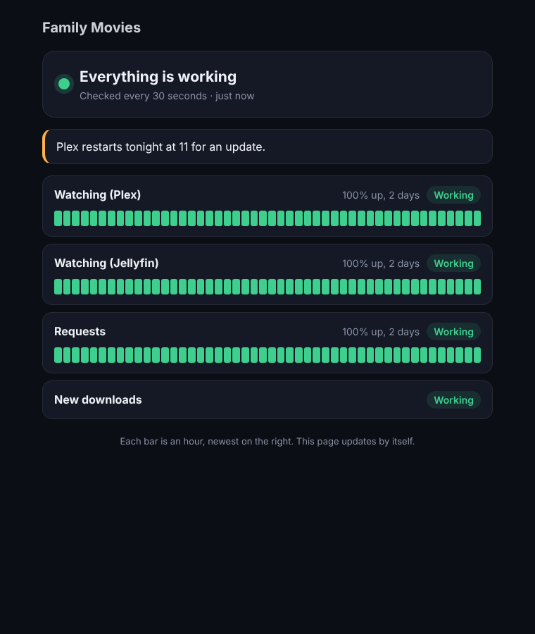
- **Suggestions**: everyone can suggest an idea or report a problem and vote for others'. Admins send them on to [this project's GitHub Issues](https://github.com/bdlnaredi/goatmediastackarr/issues), in one click with a GitHub token (a fine-grained token with *Issues: Read and write* on the repository) or by opening GitHub's new-issue page already filled in. Names stay off GitHub unless you choose otherwise.

  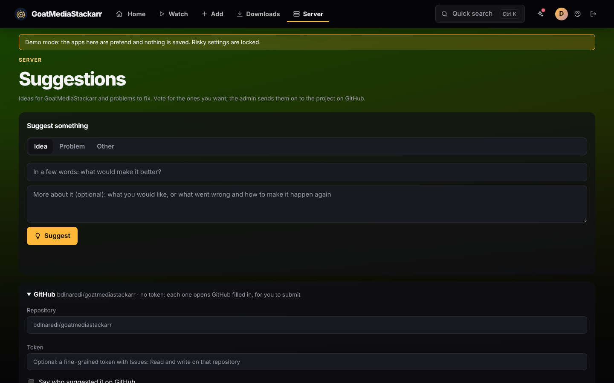

---

## On your phone and TV

### The web page, as an app

Open GoatMediaStackarr in Chrome or Edge and choose **Install** (or Settings → Account → **Install as an app**): it gets its own window and icon. On an iPhone or iPad, use Share → **Add to Home Screen**.

Settings → Account → **Turn on notifications here** sends what the bell says to that browser, even with the page closed: something you asked for is ready, a request was answered, someone wrote to you, and for admins new requests, problem reports and server problems. It works on a computer, on Android, and on iPhones and iPads (iOS 16.4 or newer) once added to the Home Screen. Each browser is turned on separately, and browsers allow it only on an HTTPS address (or localhost).

### The Android app

A native app (Kotlin and Jetpack Compose), not a web page in a frame. Same four styles, plus eight colour themes: G.O.A.T. Gold, Midnight for OLED, Ember, Aurora, Forest, Paper, Glacier and Material You.

<p>
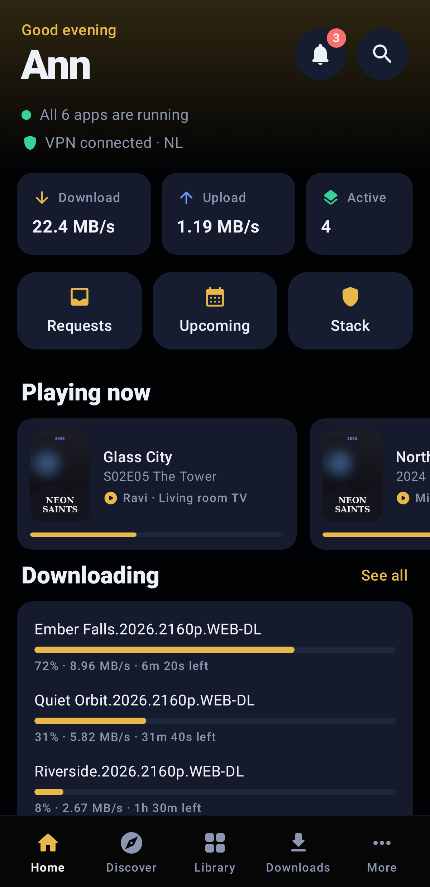
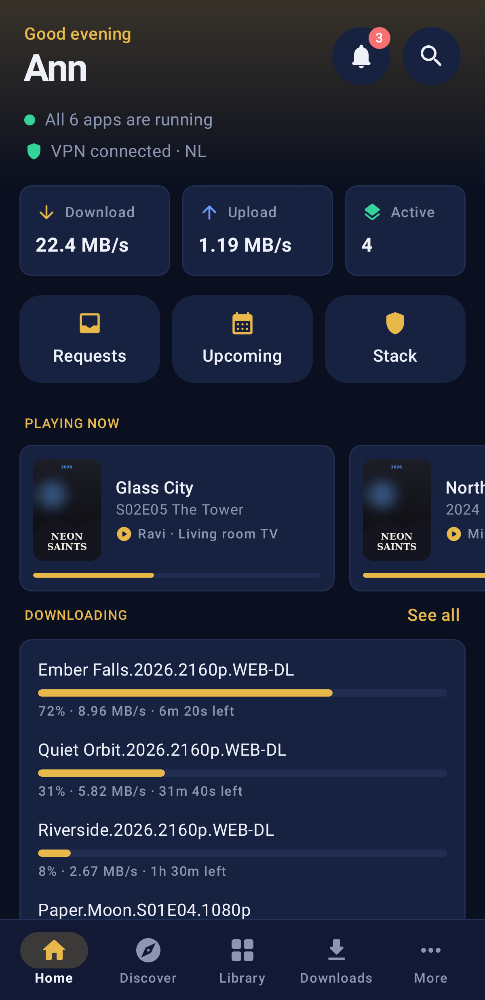
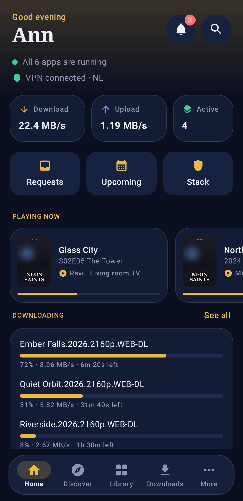
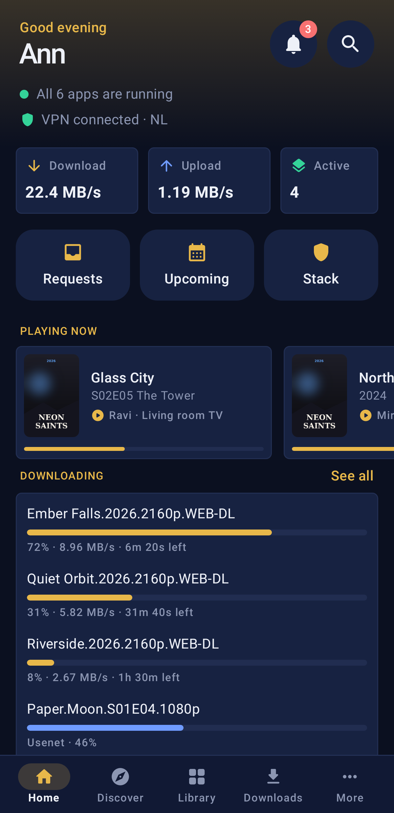
</p>
<p>
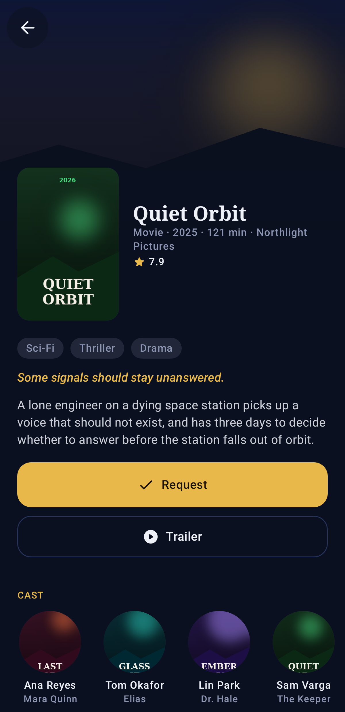
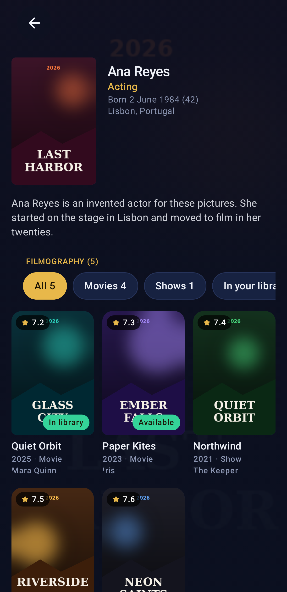
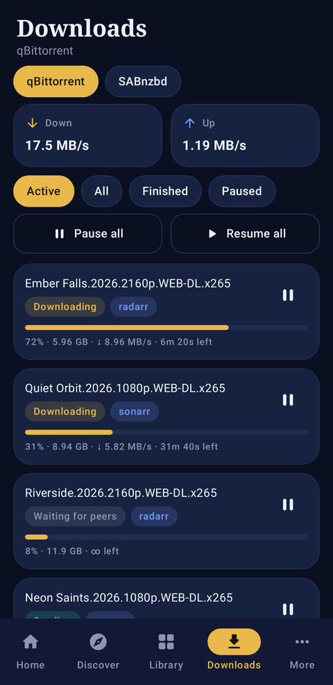
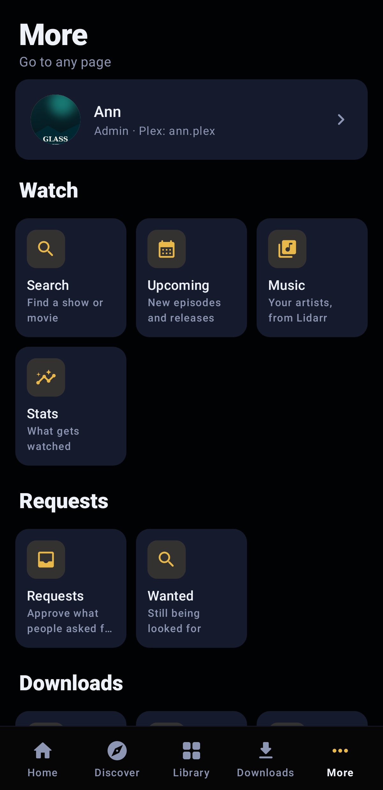
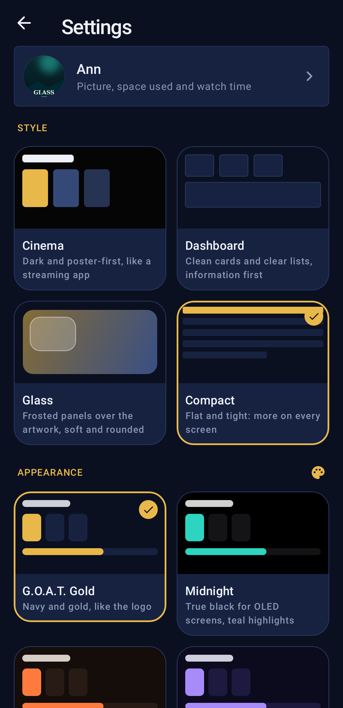
</p>

- **Home**: speeds, what's playing and downloading, what's coming, the latest requests, and whether every app and the VPN are fine. A bell with what's new for you.
- **Discover**, **Search** and **Library**, with each title's page (cast, More like this, seasons, trailer) and actors' filmographies; request through Seerr (the whole show or chosen seasons) or add straight to Sonarr or Radarr.
- **Downloads** with every client, **RSS** (tick several articles and download them at once), **Upcoming** with a calendar, **Wanted** and **Choose a release**.
- **More**: every other page in groups like the web page (Watch, Requests, Downloads, Server, You), including **Watchlist**, **Suggestions**, **Logs** (admins) and **What's new**.
- **Notifications** that work with the app closed and without Google services: something you asked for is ready, a request was approved or declined, your streaming limit; for admins also new requests, problem reports and server problems. **Approve** or **Decline** a new request, or **Pause all** downloads, straight from the notification.
- **Two home-screen widgets**: the download and upload speeds and what's playing; and what's coming up with the requests (waiting for you, or yours on the way).
- **Address at home** (Settings → Server): on your Wi-Fi the app talks to the server's local address, anywhere else the outside one, by itself.
- **Profile**: your picture, your streaming this month, the space your requests take and your watch time.
- **In your language**: English, Hindi, Spanish, German or French (Settings → Language).
- **Sign in** with your name and password (two-step codes work), a **passkey** (fingerprint or face), or **Sign in with Plex**.
- **Android TV**: the same app installs on a TV, shows on its home screen, and works with the remote's D-pad.

**Install:** download `goatmediastackarr.apk` from the [latest release](https://github.com/bdlnaredi/goatmediastackarr/releases/latest) on your phone and open it. Then enter the address you use in the browser, for example `192.168.1.10:2806`. Android 8 or newer; newer versions install over older ones, and the app tells you when one is out.

---

## The VPN

Only the apps that need it use the VPN: by default qBittorrent, SABnzbd and Prowlarr. ruTorrent's rTorrent, Deluge, cross-seed and autobrr follow qBittorrent, and FlareSolverr follows Prowlarr. Jellyfin streaming, Seerr, Sonarr, Radarr and the web pages keep your normal connection, so nobody's movie night is slowed down by a VPN.

- **Kill switch**: the VPN apps are cut off from the internet before they start, and whenever the tunnel is down. They never fall back to your home connection, but can still talk to the other apps, so Sonarr can always reach qBittorrent. Their DNS goes through the tunnel too, which also gets around providers that block indexer sites.
- **Private Internet Access (PIA)** needs no file: on the Stack page choose PIA, enter your PIA username (`p1234567`) and password, pick a region or *Fastest*, and press **Save and apply**. If PIA's website can't be reached to sign in (a DNS problem, or a blocked site), it signs in through the region's own server instead.
- **Any other provider**: put its WireGuard `.conf` (or OpenVPN `.ovpn`) file in `appdata/goatmediastackarr/vpn/`, or upload it on the Stack page, and turn the VPN on.
- **Port forwarding**: PIA's own (`VPN_PORT_FORWARD=pia`, in regions that allow it, renewed every 15 minutes) or NAT-PMP for ProtonVPN and similar (`natpmp`). The forwarded port is given to qBittorrent.
- **Leak test** on the Stack page compares the VPN apps' address with your server's own. If it doesn't connect, Logs → VPN says why.

| Setting | Default | Meaning |
|---|---|---|
| `VPN_ENABLED` | `false` | Turn the VPN on |
| `VPN_PROVIDER` | | `pia` for Private Internet Access; empty uses your file |
| `VPN_REGION` | fastest | PIA region id, like `swiss` or `ca_toronto` |
| `VPN_TYPE` | `wireguard` | `wireguard` or `openvpn` (PIA always uses WireGuard) |
| `VPN_USER`, `VPN_PASS` | | PIA sign-in, or OpenVPN sign-in if your provider needs one |
| `VPN_APPS` | `qbittorrent,sabnzbd,prowlarr` | Which apps use the VPN |
| `VPN_DNS` | from the VPN file | DNS through the tunnel |
| `VPN_PORT_FORWARD` | `off` | `pia` or `natpmp` |
| `VPN_PF_GATEWAY` | `10.2.0.1` | NAT-PMP gateway inside the tunnel |

Settings changed on the Stack page are saved in `appdata/goatmediastackarr/goat/settings.json` and win over the template. The kill switch is tested on every change, including with a real WireGuard tunnel.

---

## Switch on more apps

`GOAT_ENGINES` lists the apps to run. Take out any you don't want, and add:

- **`plex`** for a built-in Plex server: map port 32400, put a claim code from [plex.tv/claim](https://plex.tv/claim) in `PLEX_CLAIM` and start within 4 minutes. Its libraries are made for you. Plex isn't shipped in the image (it isn't open source); it is downloaded from plex.tv on first start, like the official container. `PLEX_UPDATE=false` keeps the installed version. Already have a Plex server? Add it under Settings → Apps instead; both work alongside Jellyfin.
- **`tautulli`** for Plex statistics, Stats and Year in review (needs Plex).
- **`flaresolverr`** when indexer sites show Cloudflare's "checking your browser" page. It is downloaded on first start with its own browser, added to Prowlarr as a proxy with the tag `flaresolverr` (tag the sites that need it), and follows Prowlarr onto the VPN. x86 only.
- **`rutorrent`** and **`deluge`** for more torrent apps next to qBittorrent ([below](#rutorrent-and-deluge)).
- **`cross-seed`** finds the torrents you already have on your *other* trackers and seeds them there too, with no extra download (hard links in `downloads/cross-seed`, so no extra space either). It is set up from the stack: every torrent tracker in Prowlarr, qBittorrent, Sonarr and Radarr. Each torrent that finishes in qBittorrent is searched right away, single episodes included; **Find on other trackers** on a torrent in Downloads searches it on demand; and it also checks the trackers' new releases every 30 minutes and your recent torrents once a day (`CROSSSEED_RSS_CADENCE`, `CROSSSEED_SEARCH_CADENCE`, `CROSSSEED_EXCLUDE_OLDER`). After adding a tracker to Prowlarr, restart cross-seed on the Stack page.
- **`autobrr`** grabs new releases from your private trackers' IRC announce channels the moment they appear, which is the fastest way to build ratio. Open it from the Stack page (it is at `/engines/autobrr`, admins only), make its account, add your trackers' IRC details and filters, and add qBittorrent as the download client (`127.0.0.1:8080` with the qBittorrent login from the Stack page).
- **`unpackerr`** for downloads that arrive as `.rar` (or `.zip`, `.7z`) archives, which Sonarr, Radarr and Lidarr can't import on their own. It unpacks them in the downloads folder, waits for the import, then removes the unpacked copy (the archive keeps seeding). It is connected to Sonarr, Radarr and Lidarr for you and has no page of its own; it shows on the Stack page. `UNPACKERR_PROTOCOLS=torrent,usenet` also handles usenet (SABnzbd unpacks its own by default).

Seerr works with one media server: Jellyfin when it runs, otherwise Plex. `SEERR_MEDIA_SERVER=plex` picks Plex while both run (decided on Seerr's first setup).

### ruTorrent and Deluge

**Built in.** Add `rutorrent` and/or `deluge` to `GOAT_ENGINES` and map their ports.

| | ruTorrent | Deluge |
|---|---|---|
| Its page | `http://<server>:8090` | `http://<server>:8112` |
| Sign-in | user `goat` and a password made for you | a password made for you |
| Torrent port | 50414 | 50415 |
| Settings | `appdata/goatmediastackarr/rutorrent` (your own rTorrent settings go in `rtorrent.local.rc`) | `appdata/goatmediastackarr/deluge` |

The logins are on the Stack page (*Logins made for you*), where you can change them. Sonarr, Radarr, Lidarr and Prowlarr get both as download clients after qBittorrent (used only when qBittorrent isn't available; change the priorities in their Download Clients settings to make one the main one). Finished files go to `downloads/torrents/complete`.

**Ones you already run** (in another container or on a seedbox): add them under Settings → Apps. They appear in Downloads like the built-in ones, and **Use in Sonarr/Radarr** adds them to Sonarr, Radarr and Lidarr as a download client.

---

## From outside your home

GoatMediaStackarr's own page (port 2806) is the way in to everything except Jellyfin, Seerr, Plex, ruTorrent and Deluge, which have their own ports. The other apps' own pages are at `/engines/<app>/` (Sonarr, Radarr, Lidarr, Prowlarr, Bazarr, qBittorrent, SABnzbd, Tautulli, autobrr), for admins, signed in through GoatMediaStackarr.

- **Tailscale** (the Unraid plugin): use `http://<unraid's tailscale name>:2806` in the browser and the app; the other ports work as they are. Best for watching Jellyfin away from home.
- **Cloudflare Tunnel**: point a hostname such as `goat.example.com` at port 2806, and give Jellyfin, Seerr (and ruTorrent or Deluge, if you use their pages) their own hostnames. Enter those on the Stack page under *From outside your home* so the Open buttons use them. Cloudflare's terms don't allow streaming lots of video through a free tunnel.
- **Phone apps** for Sonarr, Radarr and the others (nzb360, LunaSea, Ruddarr…): use `https://goat.example.com/engines/sonarr` (or `/engines/radarr`…) with that app's API key from its Settings → General.

## Moving from your current setup

On the Stack page, **Bring in your current setup** copies shows, movies, artists and Prowlarr indexers from the Sonarr, Radarr, Lidarr or Prowlarr you use now. Enter its address and API key, press **Check**, say where each old folder is inside GoatMediaStackarr (for example `/tv` → `/media/tv`), then **Bring in**.

- It keeps each item's monitored state, seasons, quality profile and tags, and doesn't search or download anything. With *Also bring in your settings* (on by default) your quality profiles, custom formats, delay and release profiles and file naming come first.
- Your old apps are only read from. Running it again adds only what's new. History and download clients aren't copied; indexers with a password or cookie may need it again.
- Don't run the old apps on the same media folder afterwards: both would download, rename and upgrade the same files. Stop the old containers once you're happy.

## Folders and storage

```
/media/tv            TV shows (Sonarr, Jellyfin "TV Shows")
/media/movies        Movies (Radarr, Jellyfin "Movies")
/media/music         Music (Lidarr, Jellyfin "Music")
/downloads/torrents  qBittorrent, ruTorrent and Deluge
/downloads/usenet    SABnzbd
```

**One share for everything** makes finished downloads move into the library instantly (hardlinks) instead of being copied: map `/data` to `/mnt/user/data` and set `MEDIA_DIR=/data/media` and `DOWNLOADS_DIR=/data/downloads`. Existing files are never re-owned or moved.

What's kept in `appdata/goatmediastackarr/`: each app's own folder; `goat/secrets.json` (the keys and passwords made on first start); `goat/wired.json` (what was connected on the last start); `ui/` (GoatMediaStackarr's accounts and settings); `vpn/` (your VPN file); `logs/` (each app's own log).

| Setting | Default | Meaning |
|---|---|---|
| `PUID` / `PGID` | `99` / `100` | User and group that own the files (Unraid's nobody/users) |
| `TZ` | `Etc/UTC` | Time zone |
| `UMASK` | `002` | New files are group-writable |
| `GOAT_FILEBROWSER` | `true` | File Browser: your media and downloads folders in the browser (Stack page → File Browser, admins only). `false` turns it off |
| `GOAT_APP_LOGS` | `true` | Each app of the stack keeps its own log in `/config/logs/<app>/` for the Logs page (the lines still go to the container's log too). `false` turns it off. |
| `GOAT_DNS` | *(automatic)* | DNS servers for the apps, like `1.1.1.1,8.8.8.8`. Left empty, GoatMediaStackarr checks at every start that TMDB can be looked up and, if your network's DNS fails it, adds public servers after your own. `off` leaves DNS alone |
| `TORRENT_PORT` | `50413` | qBittorrent's incoming port (6881 is blocked by many trackers) |

---

## Updates

<p align="center">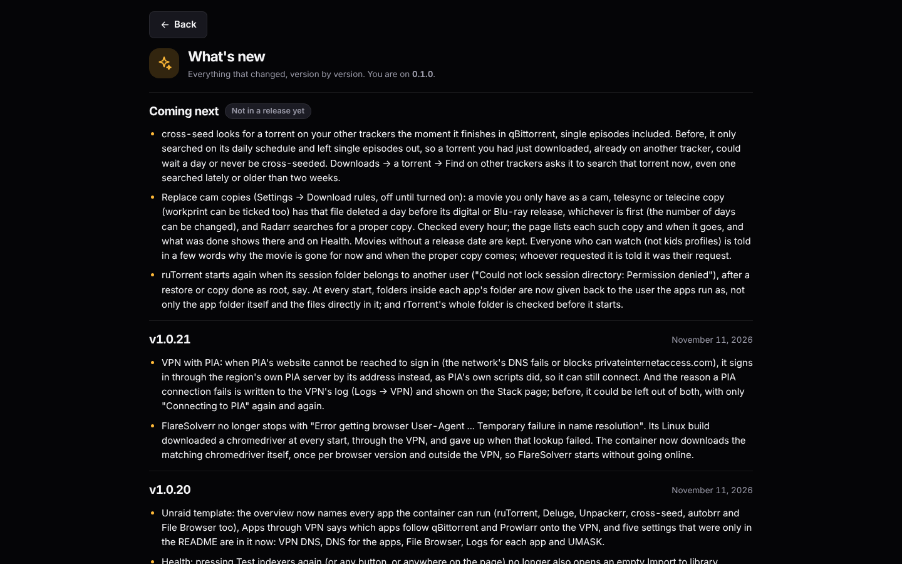</p>

- **What's new** (web page: in the menu; app: More) lists every version's changes. It opens by itself once after an update, and a dot shows until you've seen it. The same list is [CHANGELOG.md](CHANGELOG.md), and each [GitHub release](https://github.com/bdlnaredi/goatmediastackarr/releases) carries its version's notes.
- **Weekly rebuild**: every Monday GitHub rebuilds the image with the newest release of every app, runs every check, and only then publishes it as `latest` (also `weekly` and `weekly-YYYYMMDD`). Version tags such as `1.0.19` never change.
- **You choose when to update**: Unraid's Docker tab shows *update ready*; click **Update** (or let the Auto Update plugin do it). Back up App data first: a newer app can change its database so an older one can't read it. Afterwards the Stack page lists each app's version and what changed ("Sonarr 4.0.15 → 4.0.16"), and admins hear about it in the bell and on any alert channel that wants it.

## Troubleshooting

Start with **Logs** (in the Server menu) and pick *Problems*: most answers are there in plain words.

- **A connection failed on first start**: the Stack page's *Connections* says which and why. *Connect the apps again* is safe any time; failed ones are also retried at the next start.
- **Seerr: "needs a media server"**: turn on Jellyfin, or add your Plex under Settings → Apps.
- **No posters in Seerr or Discover, and `[TMDB] … ECONNRESET` in the log**: some internet providers block TMDB. Leave `GOAT_DNS` empty (it adds public DNS servers when TMDB can't be looked up), or set `GOAT_DNS=1.1.1.1,8.8.8.8`.
- **"Unable to get queue from Radarr/Sonarr" after restoring a backup**: the restored app has its old API key; the next container start fixes it.
- **The VPN keeps saying "Connecting to PIA"**: open Logs → VPN and pick *Problems*; the lines there say what failed (sign-in, the region's server, or the tunnel check).
- **Tracker websites are slow through the VPN**: pick a VPN server near you, prefer WireGuard, and add sites that allow it *without the VPN*.
- **An app says "Permission denied" on its own folder** (after restoring or copying App data as root): restart the container; every start hands each app's folders back to the user it runs as.
- **Older problems** (Seerr saying "Seerr Updated" on every visit, OpenVPN "TUNSETIFF … busy", WireGuard sending but not receiving, FlareSolverr without its browser or "version not detected", ruTorrent timing out right after a start): all fixed; update the container. [What's new](CHANGELOG.md) says in which version.

Still stuck? [Open an issue](https://github.com/bdlnaredi/goatmediastackarr/issues) with the lines that look wrong (*Save* on the Logs page gives you a file), or send it from **Suggestions**.

## Questions people ask

**I already run Sonarr, Radarr and qBittorrent. Do I start over?**
No. *Bring in your current setup* copies your shows, movies, artists, indexers and quality settings. Or keep them where they are and add them under Settings → Apps: GoatMediaStackarr works with apps it didn't start, too.

**I use Plex, not Jellyfin. Is that fine?**
Yes. Add your Plex under Settings → Apps (or run the built-in one), and take `jellyfin` out of `GOAT_ENGINES` if you don't want it.

**Will it touch my files?**
Only what Sonarr, Radarr and Lidarr do anyway: rename, move into the library, and upgrade to better copies. It never re-owns or moves your existing library. Replace cam copies only deletes when you turn it on.

**Does it work on a Raspberry Pi or other ARM board?**
Yes, 64-bit ARM, with the same image name. FlareSolverr is the one app that's x86 only.

## Licenses

GoatMediaStackarr is GPL-3.0-or-later. It runs each app's official release unchanged, under that app's own license (see [THIRD_PARTY.md](THIRD_PARTY.md)). Sonarr, Radarr, Jellyfin and the other names belong to their projects; GoatMediaStackarr isn't affiliated with or endorsed by them.

## Development

```
cd ui && npm test                 # the web page and its server, against pretend apps
node --test test/*.test.js        # settings, wiring and the control service
sudo bash test/vpn-killswitch.sh  # the kill switch, in real network namespaces
sudo bash test/vpn-wireguard.sh   # the kill switch with a real WireGuard tunnel
node scripts/screenshots.js       # these screenshots, in demo mode (also the "Update screenshots" workflow)
```

Every change is also built for Intel/AMD and ARM and started for real: every app must answer and be connected, ruTorrent and Deluge must take a torrent, FlareSolverr must open a page (and start again with DNS broken), each app must write its own log, the login passwords must change, and the VPN apps must stay offline without a VPN. The Android app is built and every screen photographed in each style. Tagging a version (`v1.0.22`) publishes the image and the app, and the GitHub release gets that version's part of the changelog.

The logo is drawn by `docs/logo/make_logo.py`, which also writes the app icons.
