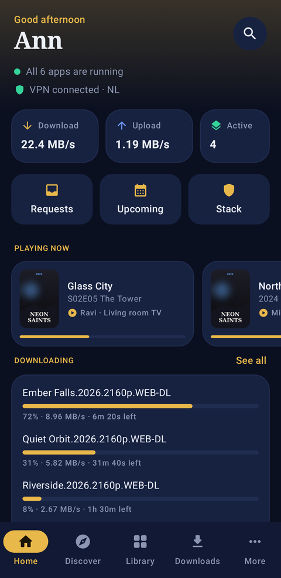
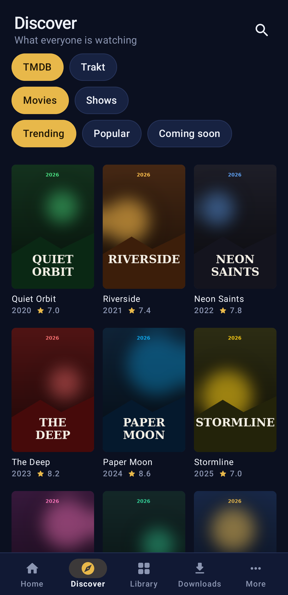
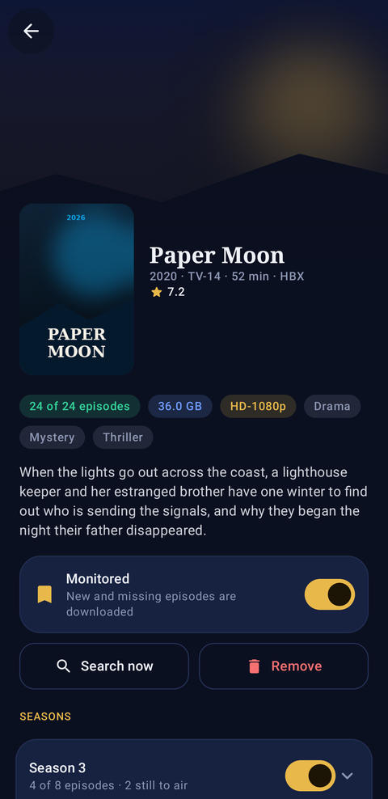
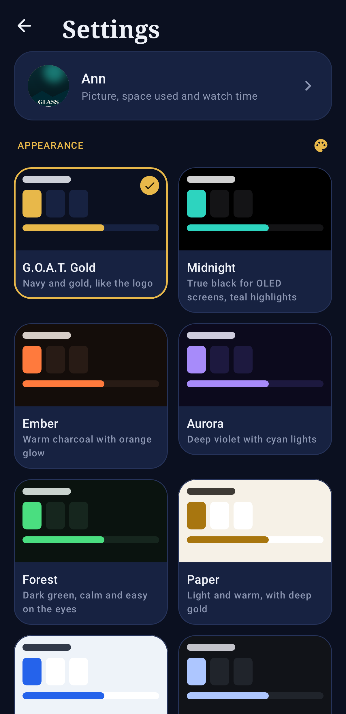
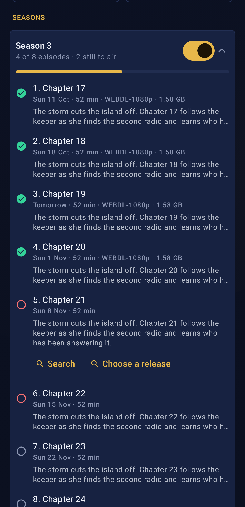
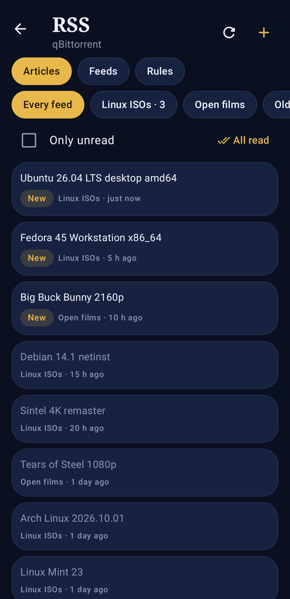
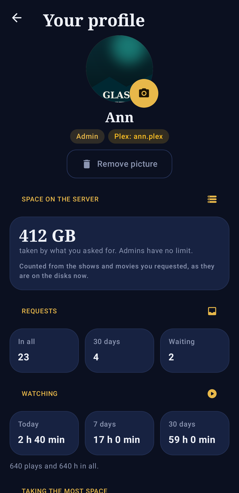
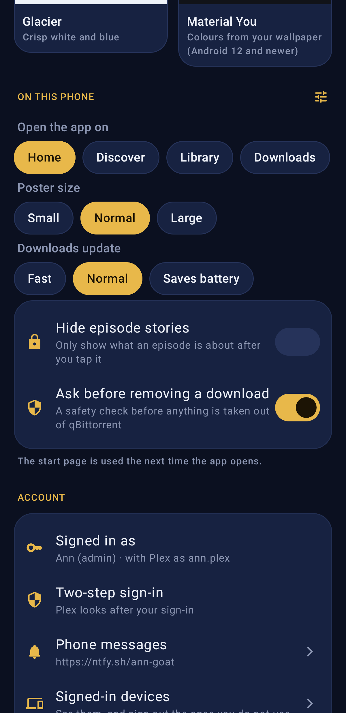

<p align="center"></p>

<h1 align="center">GoatMediaStackarr</h1>

<p align="center">A whole self-hosted media stack in <b>one container</b>, behind <b>one interface</b> and <b>one login</b>, with a <b>built-in VPN</b> for the download apps.</p>

<p align="center"></p>

---

Install one container and you get Sonarr, Radarr, Lidarr, Prowlarr, Bazarr, qBittorrent, SABnzbd, Jellyfin, Seerr and (optionally) Plex and Tautulli, already set up and connected to each other. You don't install, configure or link the separate apps.

> **Status: early (0.1).** This first stage is the container foundation: every engine bundled, wired together automatically, the VPN with its kill switch, and the interface (built from [MediaHub](https://github.com/bdlnaredi/mediahub)) with the built-in apps added for you. A setup wizard, a VPN badge and a usenet-server screen come next.

## Screenshots

| | |
|---|---|
|  |  |
| **Dashboard**: every app's status, what's downloading and what's new | **Discover**: trending and popular titles to request |
|  |  |
| **Library**: your shows, movies and music | **Downloads**: torrents and usenet in one list |
|  |  |
| **Requests**: approve what others ask for | **Upcoming**: release calendar |
|  |  |
| **Indexers**: add and test Prowlarr sites | **Health**: problems that need attention |
|  |  |
| **Stats**: what's been watched and downloaded | **Sign in** |
|  |  |
| **Usenet**: queue, history and your provider's news servers | **Settings**: apps, users, alerts, backups |
|  |  |
| **Stack**: VPN, every app's health and its own page, logins, connections | **First start**: the setup checklist |

<p align="center"></p>

Screenshots are taken in demo mode with pretend apps. To refresh them after interface changes, run **Update screenshots** from the repository's Actions tab.

## What happens when you install it

1. **One container** appears on your Unraid Docker page.
2. **First start**: every engine gets its own API key and is connected to the others:
   - Sonarr (TV), Radarr (movies) and Lidarr (music) get their library folders, plus qBittorrent and SABnzbd as download clients
   - Prowlarr sends its indexers to Sonarr, Radarr and Lidarr
   - Bazarr fetches subtitles for Sonarr and Radarr
   - Jellyfin is set up with Movies, TV Shows and Music libraries
   - Seerr signs in through Jellyfin and sends requests to Sonarr and Radarr
3. **Open `http://YOUR-SERVER:2806`** and create your admin account. All the built-in apps are already listed.
4. **Add indexers** in Prowlarr (from the indexer screen, or Advanced → Prowlarr), and your usenet server in SABnzbd if you use usenet.

The engines listen only inside the container. The only ways in are GoatMediaStackarr (port 2806), Jellyfin (port 8096, for TV and phone apps) and Seerr's request page (port 5055, with its own sign-in through Jellyfin or Plex).

## Updates and platforms

- **Weekly rebuild**: every Monday, GitHub rebuilds the image with the newest release of every engine and runs every check. Only if all of them pass is it published as `latest` (also `weekly` and `weekly-YYYYMMDD`). Unraid then offers it as an update. Version tags such as `0.2.0` don't change. After you update, the Stack page lists each app's version and what changed ("Sonarr 4.0.15 → 4.0.16"); admins also get it in the bell, and any alert channel with *Apps inside the container are updated* ticked.
- **Intel/AMD and ARM**: the same image name works on x86 servers and on 64-bit ARM (Raspberry Pi 4/5 with a 64-bit OS, ARM NAS boxes, Apple-silicon hosts). FlareSolverr is the only part that's x86-only.

## Android app

A real Android app (not a web page in a frame), with its own design and eight themes to choose from under **Settings → Appearance**: G.O.A.T. Gold, Midnight (true black for OLED), Ember, Aurora, Forest, Paper, Glacier and Material You (colours from your wallpaper, Android 12+).

<p>





</p>
<p>





</p>

- **Home**: download and upload speed, what is playing, what is downloading, what is coming up, the latest requests, and whether every app and the VPN are fine.
- **Discover** (TMDB, Trakt, TheTVDB lists) and **Search**: every movie and show opens its own page (story, cast, seasons, trailer, whether it is already in the library), with Request through Seerr (whole show or chosen seasons); or add straight to Sonarr or Radarr with a quality profile and folder.
- **Library**: your shows and movies, with what is missing; each one has a page with its seasons and episodes (with each episode's story; tap one to read all of it or search for it), monitoring, Search now and (for admins) Remove.
- **Downloads**: qBittorrent and SABnzbd, with pause, resume, force start, check and remove; add magnet links, filter by category, move a download to another category, and (admins) add or remove categories and tags.
- **RSS**: qBittorrent's feeds, newest articles first (download one into a category), feeds and auto-download rules (admins add, switch on or off, and remove them).
- **Profile**: your picture (pick one from the phone), how much you streamed this month against your limit (with the last six months), the disk space your requests take, your requests and your watch time (from Tautulli). Admins open anyone's profile from Users to set their limits.
- **Streaming limits**: everyone may stream **100 GB a month** from Plex and Jellyfin by default (admins are never limited). GoatMediaStackarr adds up each stream's bitrate every 30 seconds; at 80% the person gets a phone message (if they set one up), and at the limit their streams are stopped with a message saying when it starts again (the 1st of the next month). Change the default, count only streams from outside the home, or give someone their own limit (0 = none) in the app (Users, or their profile) or on the web page under Settings → Limits. A Plex or Jellyfin account is matched to a profile by its Plex name, or else by the profile name; accounts that match no profile are counted but not limited. Stopping Plex streams needs Plex Pass on the server's account (Jellyfin always can).
- **Space limits**: an admin can also limit the disk space someone's requests take; at the limit, new requests are refused until it is raised or something is removed.
- **Settings**: themes; the page the app opens on, poster size, how often downloads update, hiding episode stories until tapped, asking before removing; password, recovery email, phone messages, signed-in devices (sign out the ones you do not use); the server and a link to the newest app.
- **Requests** (admins approve or decline), **Upcoming**, and for admins the **Stack** page: VPN, restart any app, connect the apps again.
- Under **More**: Wanted, Music (Lidarr), Subtitles (Bazarr) and Stats (Tautulli); and for admins Health, Indexers, Usenet servers, Unraid, Users and Bring in your setup.
- **Sign in** with your GoatMediaStackarr name and password (two-step codes work), or with **Sign in with Plex**, which opens Plex's own page and comes back signed in. Plex sign-in has to be turned on on the web page first (Settings → Users → Sign in with Plex), and Plex users see only what their profile allows, as on the web. An admin links their own Plex account first (Settings → Account → Sign in with Plex); until then Plex sign-in refuses admin profiles.

**Notifications:** the app notifies you when something you asked for is ready, when a request is approved or declined, and about your streaming limit; admins also hear about new requests, problem reports and server problems (an app down, the VPN dropped, the array nearly full). It works with the app closed, without Google services. Choose which ones under Settings → Notifications.

**Updates:** the app tells you on Home when a newer version is out, with a button that downloads it; admins are also reminded to update the container.

**Install:** download `goatmediastackarr.apk` from the [latest release](https://github.com/bdlnaredi/goatmediastackarr/releases/latest) on your phone and open it (Android asks once to allow installing from your browser). Newer versions install over older ones. Open the app and enter the same address you use in the browser, for example `192.168.1.10:2806` at home. Android 8 or newer.

## Trackers: search them, browse their websites

Under **Trackers** (admins, web page and app):

- **Search** every tracker you added to Prowlarr (IPTorrents, TorrentLeech, TorrentDay…) at once, most seeders first. **Download** sends a result to qBittorrent (into the category you pick); **Page** opens the tracker's own page for it.
- **Tracker websites**: add a site's address and choose **through the VPN** (the site sees the VPN's address, like qBittorrent; if the VPN is down the site does not open) or **without the VPN**. Open it and you browse the real site, with its pictures and descriptions, in a new tab (in the app: your phone's browser). Sign in once; GoatMediaStackarr keeps the sign-in on the server. Clicking a download or magnet button on the site adds it to qBittorrent, into the site's category.

The site's pages run in a sandbox, apart from GoatMediaStackarr, so a site's own scripts cannot act as you. Sites that check you with a puzzle (Cloudflare and similar) may not open this way; for those, Prowlarr with FlareSolverr still searches them.

## ruTorrent and Deluge you already run

GoatMediaStackarr can use a ruTorrent (rTorrent) or Deluge you already have, in its own container or on a seedbox, next to the built-in qBittorrent. Add it under **Settings → Apps**:

- **ruTorrent**: the address you open ruTorrent with (like `http://192.168.1.10:8080`), and its username and password if it asks for one. GoatMediaStackarr talks to rTorrent the way Sonarr does, through ruTorrent's *httprpc* plugin (on by default); an rTorrent `RPC2` address works too. Categories are ruTorrent's labels. Removing with files uses ruTorrent's *erasedata* plugin.
- **Deluge**: the address of its Web UI (port 8112 unless changed) and the Web UI password. If the Web UI isn't connected to a Deluge daemon, GoatMediaStackarr connects it to the first one. Categories are Deluge's labels and need its *Label* plugin.

Both then appear in **Downloads** on the web page and in the app: the list, filters, pause and resume, remove, labels, details (files, trackers, peers), and adding magnet links or .torrent files. Finished downloads go into the history and the alerts. Speed-limit schedules, RSS and category paths stay qBittorrent features; use the client's own page for those.

**Use in Sonarr/Radarr** (next to it under Settings → Apps) adds it to your Sonarr, Radarr and Lidarr as a download client, using each app's own template; each app tests the connection before saving. Sonarr and Radarr need to see its finished files: if the client saves them somewhere they don't see at the same path, add a *Remote Path Mapping* in their Settings → Download Clients.

## Using it from outside your home

GoatMediaStackarr's own page (port 2806) is the way in to everything except Jellyfin, Seerr and Plex: Sonarr, Radarr, Lidarr, Prowlarr, Bazarr, qBittorrent, SABnzbd and Tautulli open at `/engines/<app>/` on the same address, signed in through GoatMediaStackarr (admins only).

- **Tailscale** (the Unraid Tailscale plugin, so Unraid itself is on your tailnet): use `http://<unraid's tailscale name>:2806` in the browser and the app. Jellyfin (`:8096`), Seerr (`:5055`) and Plex (`:32400`) work on their ports as they are.
- **Cloudflare Tunnel**: add a public hostname such as `goat.example.com` pointing to `http://<unraid's address>:2806`. For Jellyfin and Seerr add their own hostnames (`jellyfin.example.com` to port 8096, `requests.example.com` to port 5055) and enter them on the Stack page under *From outside your home*, so the Open buttons use them away from home. Plex has its own remote access; use that. Cloudflare's terms do not allow streaming lots of video through a free tunnel, so Tailscale is the better way to watch Jellyfin away from home.
- **Phone apps** for Sonarr, Radarr and the others (nzb360, LunaSea, Ruddarr…): the address is `https://goat.example.com/engines/sonarr` (or `/engines/radarr`, `/engines/prowlarr`…) with that app's API key, which you find in the app under Settings → General. qBittorrent's phone apps need a sign-in GoatMediaStackarr cannot pass on, so use the Downloads page instead.

## Install on Unraid

Use the template in [`unraid/goatmediastackarr.xml`](unraid/goatmediastackarr.xml), or add a container with:

| Setting | Value |
|---|---|
| Repository | `ghcr.io/bdlnaredi/goatmediastackarr:latest` |
| Port 2806 | GoatMediaStackarr |
| Port 8096 | Jellyfin |
| Port 5055 | Seerr request page |
| Port 32400 | Plex, only if turned on |
| `/config` | `/mnt/user/appdata/goatmediastackarr` (every app's settings; back this up) |
| `/media` | `/mnt/user/media` (your library) |
| `/downloads` | `/mnt/user/downloads` (torrent and usenet downloads) |
| Extra parameters | `--cap-add=NET_ADMIN --device=/dev/net/tun --sysctl net.ipv4.conf.all.src_valid_mark=1 --sysctl net.ipv4.conf.all.rp_filter=2` |

Other systems: see [`docker-compose.yml`](docker-compose.yml).

### Folders

By default the library and the downloads are two separate folders:

```
/media/tv               TV shows (Sonarr, Jellyfin "TV Shows")
/media/movies           Movies (Radarr, Jellyfin "Movies")
/media/music            Music (Lidarr, Jellyfin "Music")
/downloads/torrents     qBittorrent (incomplete and complete)
/downloads/usenet       SABnzbd (incomplete and complete)
```

**Both inside one folder.** If you prefer one share for everything, map a single folder and point both settings inside it:

| Setting | Value |
|---|---|
| `/data` | `/mnt/user/data` |
| `MEDIA_DIR` | `/data/media` |
| `DOWNLOADS_DIR` | `/data/downloads` |

This has one advantage: finished downloads are moved into the library instantly (hardlinked) instead of copied. With two separate mappings they are copied, which is slower and briefly uses double the space, even when both folders are on the same disk.

Existing files in your media and downloads folders are never re-owned or moved.

**Space.** The image is about 2.8 GB. Jellyfin refuses to start when the app data folder has less than 2 GB free, so leave some room there.

## The VPN

Only the apps that need it use the VPN. By default those are qBittorrent, SABnzbd and Prowlarr. Jellyfin streaming, Seerr, Sonarr, Radarr and the interface keep using your normal internet.

1. Set **VPN on** (`VPN_ENABLED`) to `true`.
2. Download a WireGuard `.conf` (or OpenVPN `.ovpn`) file from your VPN provider and put it in `appdata/goatmediastackarr/vpn/`.
3. For OpenVPN, set **VPN type** to `openvpn`, plus **VPN username** and **VPN password** if your provider uses them.

**Private Internet Access (PIA)** needs no file. On the Stack page, under VPN, choose **Private Internet Access (PIA)**, enter your PIA username (it starts with p, like `p1234567`) and password, pick a region or leave it on *Fastest*, and press **Save and apply**. GoatMediaStackarr signs in to PIA, registers a new WireGuard key on the region's server and connects, the same way PIA's own Linux scripts do; it does it again on every reconnect. In the template: `VPN_PROVIDER=pia`, `VPN_USER`, `VPN_PASS` and optionally `VPN_REGION` (a region id like `swiss` or `ca_toronto`).

**Kill switch.** The VPN apps are blocked from the internet before they even start, and they stay blocked whenever the tunnel is down. They never fall back to your home connection. They can still talk to the other apps inside the container, so Sonarr can always tell qBittorrent what to download.

**DNS** for the VPN apps goes through the tunnel too, which also gets around ISP blocks on indexer sites.

**Port forwarding.** For ProtonVPN and other NAT-PMP providers, set `VPN_PORT_FORWARD=natpmp`. For PIA, choose *PIA port forwarding* (`VPN_PORT_FORWARD=pia`); PIA only allows it in some regions (they are marked in the list, and *Fastest* then picks only those), and it is renewed every 15 minutes. Either way the forwarded port is set in qBittorrent automatically.

| Variable | Default | Meaning |
|---|---|---|
| `VPN_ENABLED` | `false` | Turn the VPN on |
| `VPN_PROVIDER` | | `pia` for Private Internet Access (no file needed); empty uses your file |
| `VPN_REGION` | fastest | PIA region id, like `swiss`, `uk_london` or `ca_toronto` |
| `VPN_TYPE` | `wireguard` | `wireguard` or `openvpn` (PIA always uses WireGuard) |
| `VPN_USER`, `VPN_PASS` | | PIA sign-in, or OpenVPN sign-in if needed |
| `VPN_APPS` | `qbittorrent,sabnzbd,prowlarr` | Which apps use the VPN |
| `VPN_DNS` | from the VPN file | DNS server used through the tunnel |
| `VPN_PORT_FORWARD` | `off` | `pia` for PIA, `natpmp` for ProtonVPN-style port forwarding |
| `VPN_PF_GATEWAY` | `10.2.0.1` | NAT-PMP gateway inside the tunnel |

Unraid 7 includes WireGuard. If your server's kernel does not, use an OpenVPN file instead.

## The Stack page

Admins get a **Stack** page (`/stack`) for everything about the container itself:

- **Setup checklist** on first start: connections, VPN, indexers, usenet, Plex.
- **VPN**: on or off, Private Internet Access (PIA) with a region list or upload your provider's file, pick which apps use it, OpenVPN login, port forwarding, **Save and apply**, and a **Leak test** that compares the VPN apps' address with your server's own.
- **Apps**: each engine's health, its own page, and a **Restart** button.
- **Logins made for you**: the Jellyfin admin and qBittorrent passwords.
- **Plex**: link the built-in Plex with a claim code.
- **Connections**: what was wired up on start, and a button to run it again.
- **Bring in your current setup** (see below).

Settings changed here are saved in `appdata/goatmediastackarr/goat/settings.json` and take priority over the Unraid template.

## Moving from your current setup

On the Stack page, under **Bring in your current setup**, pick Sonarr, Radarr, Lidarr or Prowlarr, then enter your current app's address and API key (found in that app under Settings → General). **Check** shows how many shows, movies, artists or indexers there are, and how many are already here.

Then say where each old folder is inside GoatMediaStackarr. For example, if your old Sonarr saw your shows at `/tv` and GoatMediaStackarr sees the same share at `/media/tv`, map `/tv` → `/media/tv`. **Bring in** copies everything that's missing. It keeps each item's monitored state, seasons and quality profile, and doesn't search or download anything.

With **Also bring in your settings** ticked (the default), these are copied first: quality profiles, custom formats, delay profiles, release profiles and file naming. One with the same name here is replaced by yours, and the scores in each profile follow their custom formats by name. Tags are always kept, on shows, movies, artists and Prowlarr indexers. Not copied: download clients (the built-in ones are already set up) and history. The built-in app then rescans the folders and finds your files where they already are.

- Your old apps are only read from, never changed. Running the import again adds only what's new.
- Download history and episode-by-episode settings aren't copied.
- Indexers that need a password or cookie may need it entered again. Test them on the Indexers page afterwards.

## Usenet

On the Usenet page, admins can add their provider's news server (address, port, SSL, connections, login), test it, change it or remove it.

## Addresses

Every page has its own address, such as `/downloads`, `/library`, `/stack` or `/settings/apps`. Shows and movies have one too (`/library/tv/<app>/<id>`), so you can bookmark or share one. Bookmarks, links and the Back button work. A dialog opened over a page counts as a step back, so Back (or a phone's back gesture) closes it.

## Advanced: each app's own page

Admins can open any engine's original page through GoatMediaStackarr, signed in with their GoatMediaStackarr account:

`/engines/sonarr/`, `/engines/radarr/`, `/engines/lidarr/`, `/engines/prowlarr/`, `/engines/bazarr/`, `/engines/qbittorrent/`, `/engines/sabnzbd/`, `/engines/tautulli/`

Jellyfin is at port 8096. Its admin user is `goat-admin`; the password is `jellyfinPass` in `appdata/goatmediastackarr/goat/secrets.json`. Change it in Jellyfin if you like.

## Choosing apps

`GOAT_ENGINES` lists the apps to run. Remove any you don't want.

- Add `plex` for a built-in Plex server (see below).
- Add `tautulli` for Plex statistics. Tautulli only works with Plex.
- Add `flaresolverr` if some indexer sites show Cloudflare's "checking your browser" page. See below.

## FlareSolverr

Some torrent sites sit behind Cloudflare, which blocks Prowlarr with a "checking your browser" page. FlareSolverr opens those sites in a real browser to get past it.

1. Add `flaresolverr` to `GOAT_ENGINES`. On first start it downloads FlareSolverr (it brings its own Chromium browser) and adds the libraries that browser needs. Nothing is added to the image for people who don't use it.
2. GoatMediaStackarr adds it to Prowlarr as a proxy with the tag `flaresolverr`.
3. In Prowlarr (Indexers page, or Stack → Prowlarr → Open), give the sites that need it the `flaresolverr` tag.

When Prowlarr uses the VPN, FlareSolverr does too, since it's the one visiting the sites. FlareSolverr only offers a ready-made build for x86 servers, so it isn't available on ARM.

## Plex

There are two ways to use Plex. You can also use both Plex and Jellyfin together on the same media folders.

**Your existing Plex server.** Add it in Settings → Apps with its address and token, as with any other app. Nothing else changes.

**Built-in Plex** (off by default):

1. Add `plex` to `GOAT_ENGINES` and map port 32400.
2. Get a claim code from [plex.tv/claim](https://plex.tv/claim), put it in `PLEX_CLAIM`, and start the container within 4 minutes. This links the new server to your Plex account. It's only needed once.
3. GoatMediaStackarr then creates Movies, TV Shows and Music libraries on your media folders. If Tautulli is turned on, it is connected to Plex automatically.

Plex is free to use but not open source. So it isn't shipped inside this image. It is downloaded from plex.tv on first start, the same way the official Plex container does it. `PLEX_UPDATE=false` keeps the installed version. Hardware transcoding needs Plex Pass, as usual.

**Seerr** works with one media server. It uses Jellyfin when Jellyfin runs, otherwise Plex. Set `SEERR_MEDIA_SERVER=plex` to use Plex while both run. This choice is made on Seerr's first setup.

## Other settings

| Variable | Default | Meaning |
|---|---|---|
| `PUID` / `PGID` | `99` / `100` | User and group that own the files (Unraid's nobody/users) |
| `TZ` | `Etc/UTC` | Time zone |
| `UMASK` | `002` | New files are group-writable |

## Where things are kept

`appdata/goatmediastackarr/`:

- `<app>/`: each engine's own settings and database
- `goat/secrets.json`: the keys and passwords made on first start
- `goat/wired.json`: what was connected on the last start, and any errors
- `ui/`: GoatMediaStackarr accounts and settings
- `vpn/`: your VPN file

If a connection fails on first start (for example an engine was slow), it is retried at the next container start. Settings you change inside an engine are kept; only the addresses and keys GoatMediaStackarr manages are rewritten.

## Bundled software and licenses

GoatMediaStackarr is GPL-3.0-or-later. It runs the official releases of each engine unchanged. They keep their own licenses: see [THIRD_PARTY.md](THIRD_PARTY.md). The names Sonarr, Radarr, Jellyfin and the others belong to their projects. GoatMediaStackarr is not affiliated with or endorsed by them.

## Development

```
npm test                         # settings, wiring (against fake engines) and the interface
sudo bash test/vpn-killswitch.sh # the kill switch for real, in Linux network namespaces
```

CI also builds the image, starts it, and checks that every engine answers and is connected.

The logo is drawn by `docs/logo/make_logo.py`, which also writes the app icons in `ui/public`.
