<p align="center"></p>

<h1 align="center">GoatMediaStackarr</h1>

<p align="center"><b>Your whole media server in one container.</b><br>
Sonarr, Radarr, Lidarr, Prowlarr, Bazarr, qBittorrent, SABnzbd, Jellyfin and Seerr, already set up and talking to each other,<br>
behind one web page, one Android app and one login, with a VPN and kill switch for the download apps.</p>

<p align="center">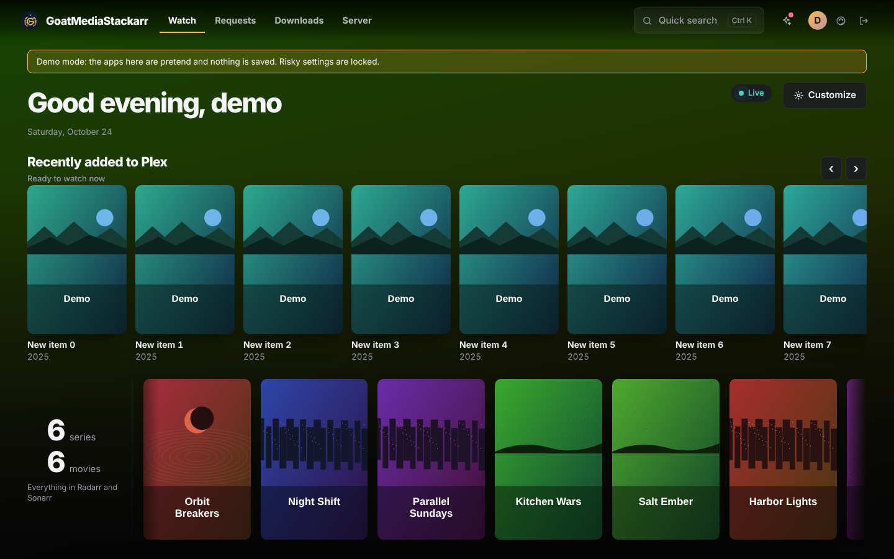</p>

<p align="center">
<a href="#install-on-unraid">Install</a> ·
<a href="#four-styles">Four styles</a> ·
<a href="#the-web-page">Web page</a> ·
<a href="#the-android-app">Android app</a> ·
<a href="#the-vpn">VPN</a> ·
<a href="#whats-new-and-updates">What's new</a> ·
<a href="#troubleshooting">Troubleshooting</a>
</p>

---

## What you get

You install **one** container. On its first start it gives every app its own keys and passwords, connects them all to each other, and opens a web page where you sign in once and run everything: watch what's new, ask for shows and movies, follow downloads, and look after the server. The same things are in a native Android app.

| Built in, on by default | Built in, turn on when you want it | Bring your own |
|---|---|---|
| Sonarr (TV) · Radarr (movies) · Lidarr (music) · Prowlarr (indexers) · Bazarr (subtitles) · qBittorrent · SABnzbd (usenet) · Jellyfin · Seerr (requests) | Plex · Tautulli · FlareSolverr · ruTorrent (with rTorrent) · Deluge | Any of the above you already run, plus Readarr, Jackett, Unraid itself, and an existing Plex |

- **Already connected**: library folders and download clients in Sonarr, Radarr and Lidarr; Prowlarr sends its indexers to all three; Bazarr works with Sonarr and Radarr; Jellyfin gets Movies, TV Shows and Music; Seerr signs in through Jellyfin or Plex and sends requests to Sonarr and Radarr.
- **Kept connected**: every start checks the connections again, so a restored backup with an old API key just works.
- **Private by default**: the apps listen only inside the container. You reach them through GoatMediaStackarr, signed in.
- **Intel/AMD and ARM**: one image name for both, rebuilt every week with the newest release of every app, and published only when every check passes.

> **Status: 0.7.x.** Everything here is tested on every change, inside the real image on both kinds of processor. It is still young: try it before you trust it with a library you can't replace. The web page grew out of [MediaHub](https://github.com/bdlnaredi/mediahub).

## Four styles

Pick the look under **Appearance → Style** on the web page, or **Settings → Style** in the app. Each style is a whole design (shapes, spacing, surfaces, how much artwork shows, and on a computer even where the menu is), and each works in light and dark with every accent colour.

| | |
|---|---|
|  | 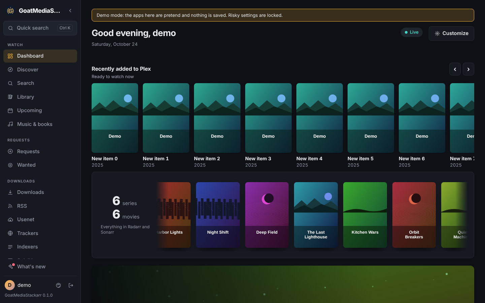 |
| **Cinema** (the default): dark and poster-first like a streaming app, with the menu as a bar across the top | **Dashboard**: clean cards and clear lists, information first |
| 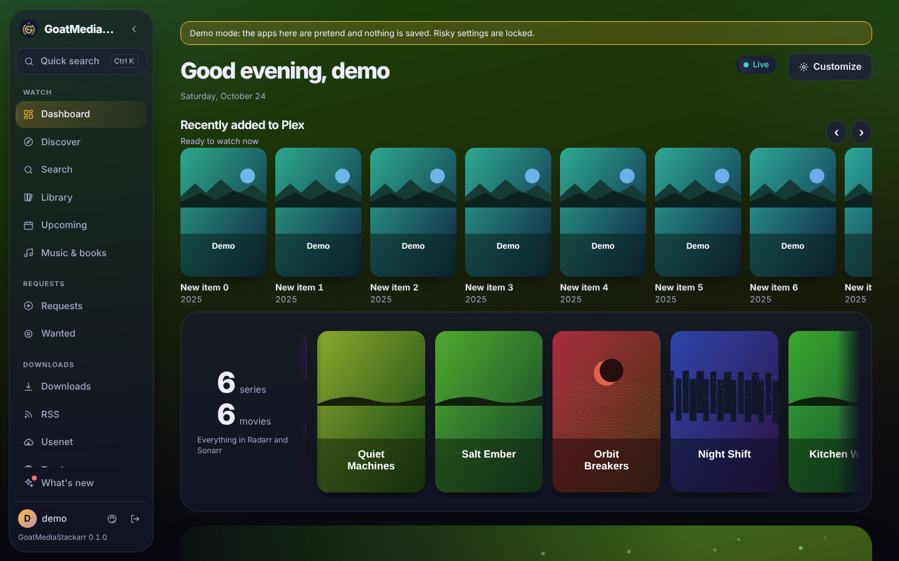 | 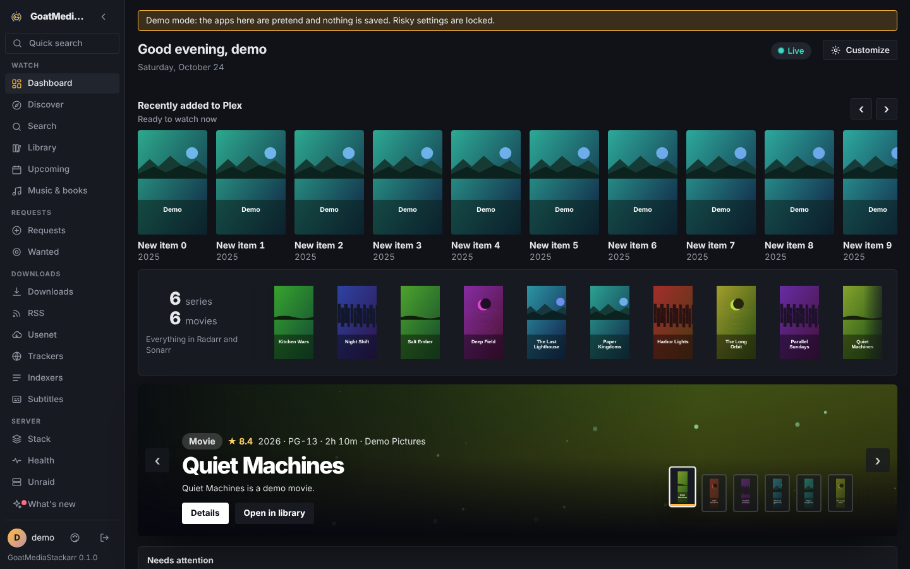 |
| **Glass**: frosted panels floating over your artwork | **Compact**: flat and tight, more on every screen, light on older devices |

<p align="center">
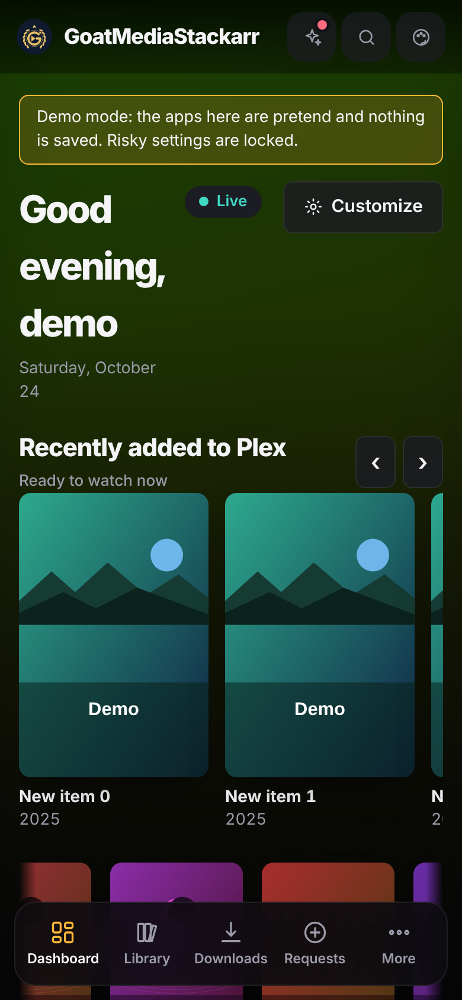
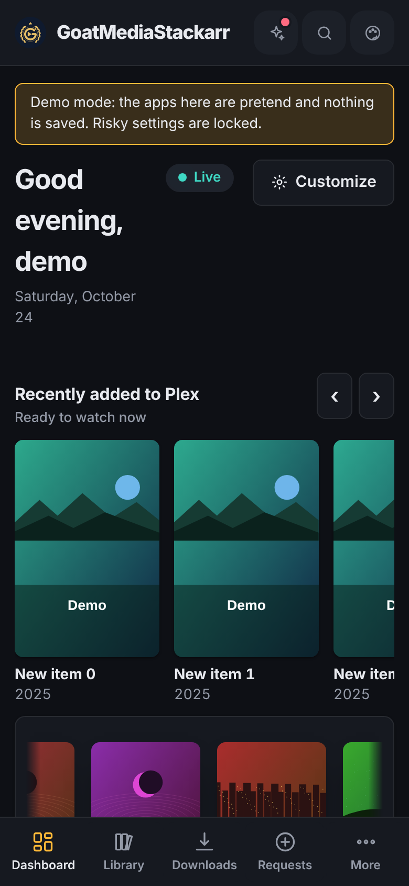
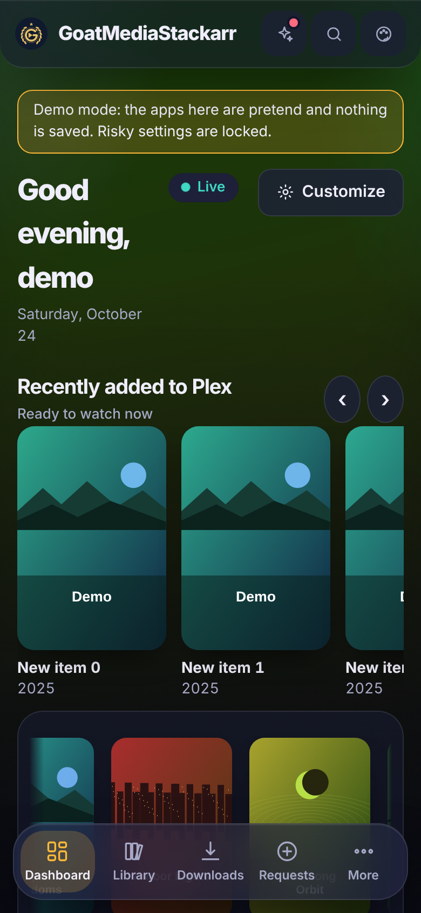
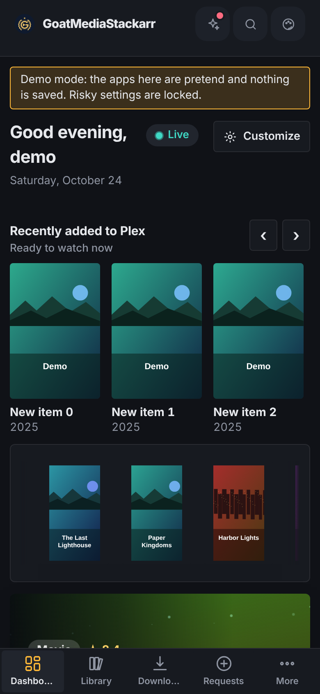
</p>

## Install on Unraid

1. **Add the container.** Use the template in [`unraid/goatmediastackarr.xml`](unraid/goatmediastackarr.xml) (the [MediaHub](https://github.com/bdlnaredi/mediahub) repository carries the same one), or add a container by hand:

   | Setting | Value |
   |---|---|
   | Repository | `ghcr.io/bdlnaredi/goatmediastackarr:latest` |
   | `/config` | `/mnt/user/appdata/goatmediastackarr` (every app's settings: back this up) |
   | `/media` | `/mnt/user/media` (your library) |
   | `/downloads` | `/mnt/user/downloads` (torrents and usenet) |
   | Ports | `2806` GoatMediaStackarr · `8096` Jellyfin · `5055` Seerr · and only if turned on: `32400` Plex, `8090` ruTorrent, `8112` Deluge |
   | Extra parameters | `--cap-add=NET_ADMIN --device=/dev/net/tun --sysctl net.ipv4.conf.all.src_valid_mark=1 --sysctl net.ipv4.conf.all.rp_filter=2` |

   Not on Unraid? Use [`docker-compose.yml`](docker-compose.yml).
2. **Start it** and give it a few minutes: the first start sets up and connects every app.
3. **Open `http://YOUR-SERVER:2806`** and make your admin account. You land on the **Stack** page and its setup checklist.
4. **Add indexers** (Indexers page, or Prowlarr's own page), and your news server under **Usenet** if you use usenet.
5. **Turn on the VPN** if you want one (see [The VPN](#the-vpn)).

Keep App data on a cache drive or SSD with room to grow. The image is about 2.5 GB; Jellyfin won't start with less than 2 GB free in App data, and FlareSolverr needs about 1.5 GB when it is turned on.

<p align="center">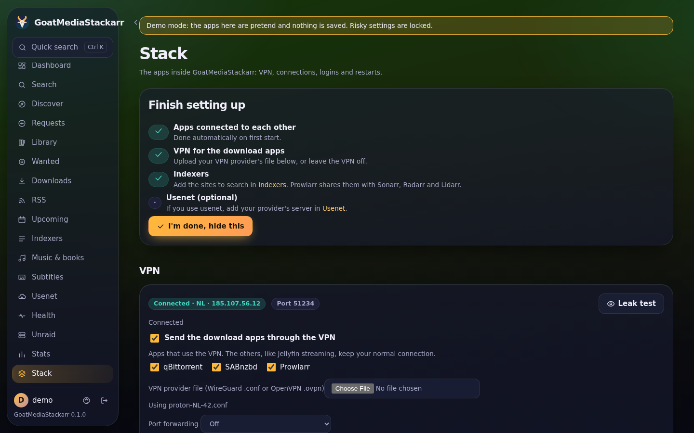</p>

## The web page

Open `http://YOUR-SERVER:2806`. It works on a phone as well as a computer. Every page has its own address (`/downloads`, `/library`, `/settings/alerts`…), so bookmarks, links and the Back button work, and a pop-up counts as a step back. **Ctrl K** (or `/`) opens quick search for pages, downloads, requests and the library.

The menu has four groups. In the Cinema style they are drop-downs on the bar across the top; in the others a side menu; on a phone the bottom bar has Dashboard, Library, Downloads and Requests, and **More** lists the rest by group.

<p align="center">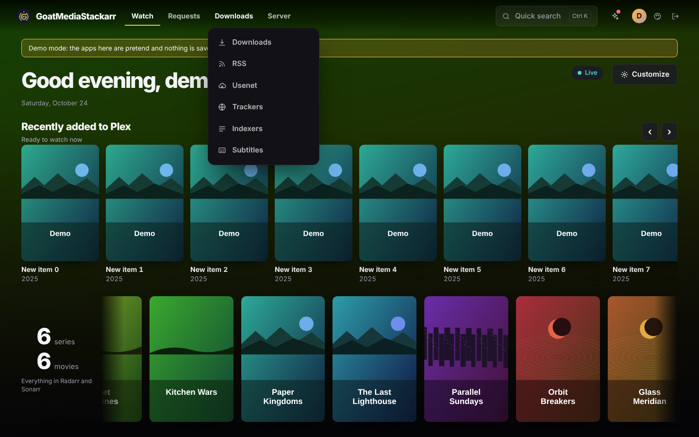</p>

### Watch

- **Dashboard**: what is playing (and who is watching), the download and upload speed, the server's health, and what needs your attention. A big drifting poster wall of your library, featured titles with back and forward buttons, *Recently added to Plex* (ready to watch), *Recently added to Radarr and Sonarr* (may still be downloading), top rated and coming up. Choose what it shows and in which order with **Customize**.
- **Discover** and **Search**: what is trending, popular and coming on TMDB, Trakt and TheTVDB, and a search across Sonarr and Radarr.
- **Library**: your shows and movies, as posters or a list, with filters. A show's page has its seasons and episodes (each with its story), monitoring, search and **Choose a release** (pick a release yourself from what your indexers have).
- **Every title has its own page**: story, cast, seasons, trailer, whether it is in your library, and **More like this**. Tap an actor for their own page with everything they were in, filterable to movies, shows or what you already have; any title there can be opened and requested.
- **Watchlist**: everyone keeps their own list of what they want to watch, from any title's page. It shows which are here, on their way or not asked for yet, and each person gets a message when theirs lands. Admins can have titles on a watchlist asked for automatically.
- **Collections** and **Because you watched**: a movie's page says which collection it belongs to, the collection's page lists every film in it with *Request the missing ones*, Radarr's collections are under Library, and the dashboard suggests titles from what each person actually watched.
- **Missing episodes**: a show's page lists the episodes that aren't here, and each can be asked for on its own.
- **Upcoming**: the next two weeks, or a month calendar.
- **Music & books**: Lidarr's artists and Readarr's authors.

| | |
|---|---|
|  |  |
| 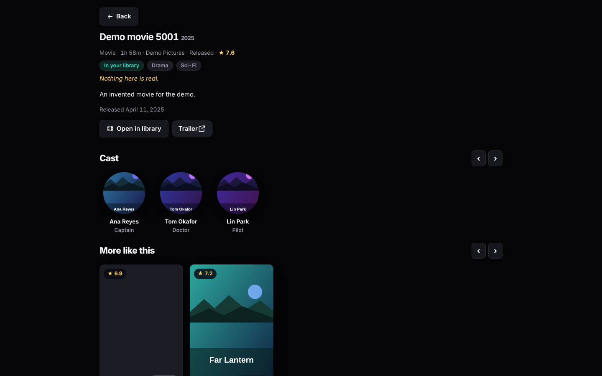 | 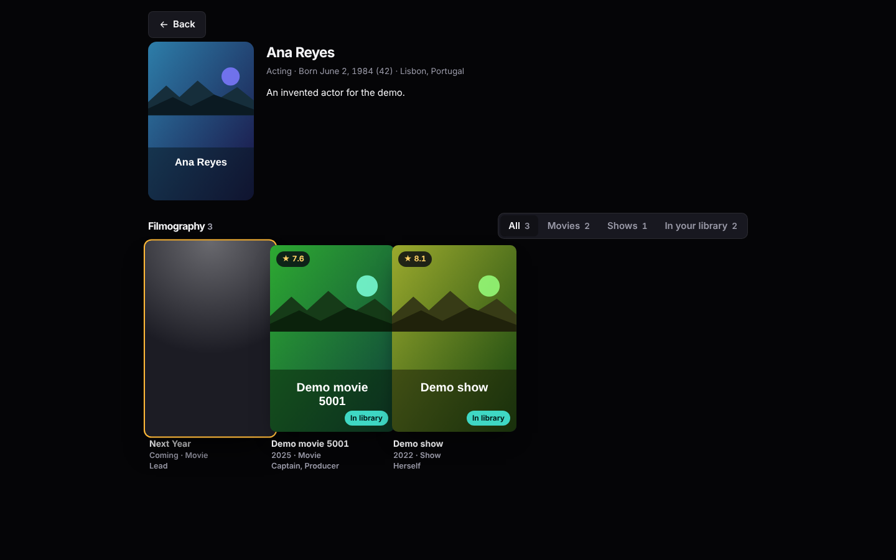 |
| 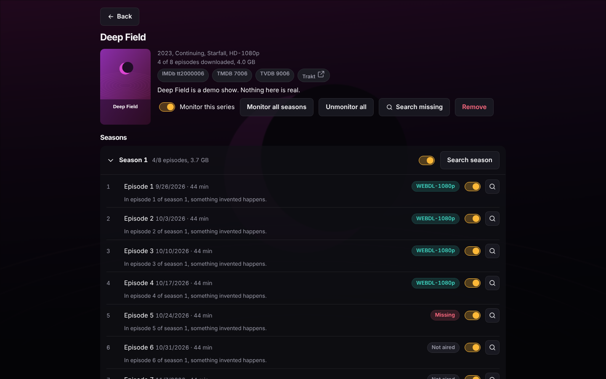 |  |

### Requests

- **Requests**: anyone can ask for a show or movie; admins approve or decline (or let a profile approve itself). Each request shows where it really is: *Requested*, *Approved*, *Looking for a download*, *Downloading* (how far, how long), *Copying to the library*, *In the library* and *Available*. Request limits per person.
- **Wanted**: what Sonarr and Radarr are still looking for, with **Choose a release** on each.

### Downloads

- **Downloads**: qBittorrent, ruTorrent, Deluge and SABnzbd in one list: pause, resume, remove, categories and tags, files, trackers, peers, speed limits and schedules, and adding links or `.torrent` files.
- **RSS**: qBittorrent's feeds and auto-download rules.
- **Usenet**: SABnzbd's queue and history, and your provider's news servers (add, test, change, remove).
- **Trackers** (admins): search all your Prowlarr trackers at once and send a result to qBittorrent; or browse a tracker's own website inside GoatMediaStackarr, through the VPN or not, signed in once, with every download or magnet button going straight to qBittorrent.
- **Indexers**: search, test and remove the sites in Prowlarr and Jackett. **Subtitles**: what Bazarr is still missing.

| | |
|---|---|
|  |  |
| 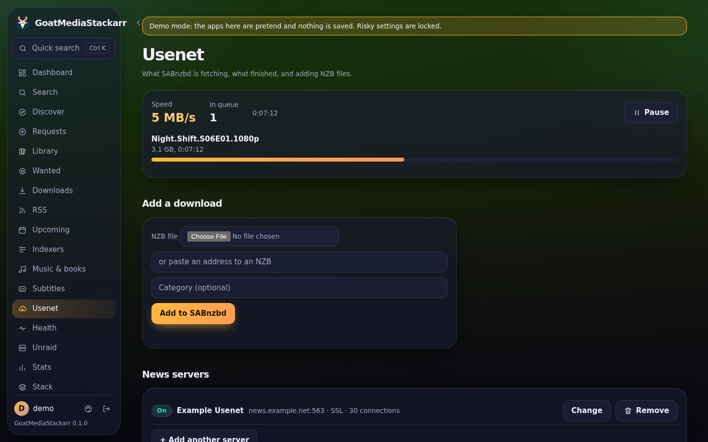 |  |

### Server

- **Stack** (admins): everything about the container. The VPN (on or off, PIA with a region list or your provider's file, which apps use it, port forwarding, a leak test); every app's health and version with **Restart**, **Stop**, **Start** and its own page; what changed after an update; **Logins made for you** (Jellyfin, qBittorrent, ruTorrent, Deluge) with **Change** to set your own password, which Sonarr, Radarr, Lidarr and Prowlarr are given too; the outside addresses for the Open buttons; linking Plex; and the connections, with a button to run them again.
- **File Browser** (admins): the media and downloads folders in the browser, opened from the Stack page: upload, download, rename, move and delete files.
- **Health**: problems the apps report, stuck downloads, and disk space per folder. **Fix problems by itself** (on by default) removes, blocks and searches again for downloads that failed or have not moved for a day, and restarts a built-in app that stops answering; every fix is listed here.
- **Unraid**: the array, disks and containers, if you add your Unraid server. **Stats**: what gets watched, from Tautulli.
- **Settings**: *Account* (password, two-step sign-in, Sign in with Plex, devices), *Appearance*, *Apps*, *Discover lists*, *Users* (what each profile can see and do), *Limits* (streaming per month and disk space per person), *Status pages*, *Alerts* (email, ntfy, Discord, Telegram, Pushover, Gotify or any webhook, each with its own list of what it hears about), *Download rules*, *Backup* and *Activity*.
- **Kids profiles** (Settings → Users): a simpler look with only what is in the library and rated for their age, and no searching or requesting.
- **Invite links** (Settings → Users): a link or QR code that lets people make their own profile, with the apps and rights you choose, for a day, a week, a month or until you remove it.
- **Backups of the whole stack** (Settings → Backup): every app's settings and databases in one file, daily or weekly, and a guided *Put back* that restores only the apps you pick (with a copy of how they were just before).
- **Weekly email for everyone** (Settings → Alerts): each person with an email address gets their own week: their requests and watchlist titles that came in, what is new and what is coming.

| | |
|---|---|
| 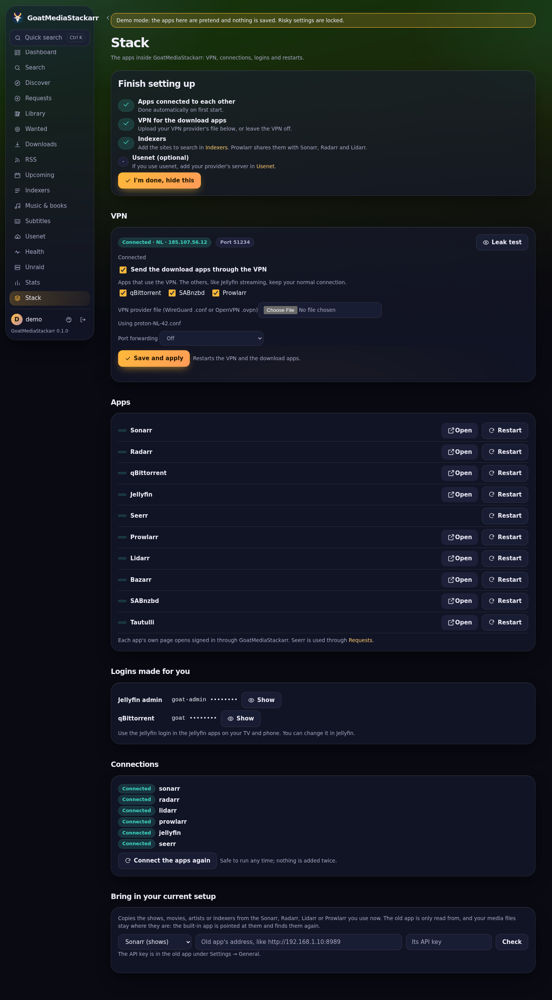 |  |
| 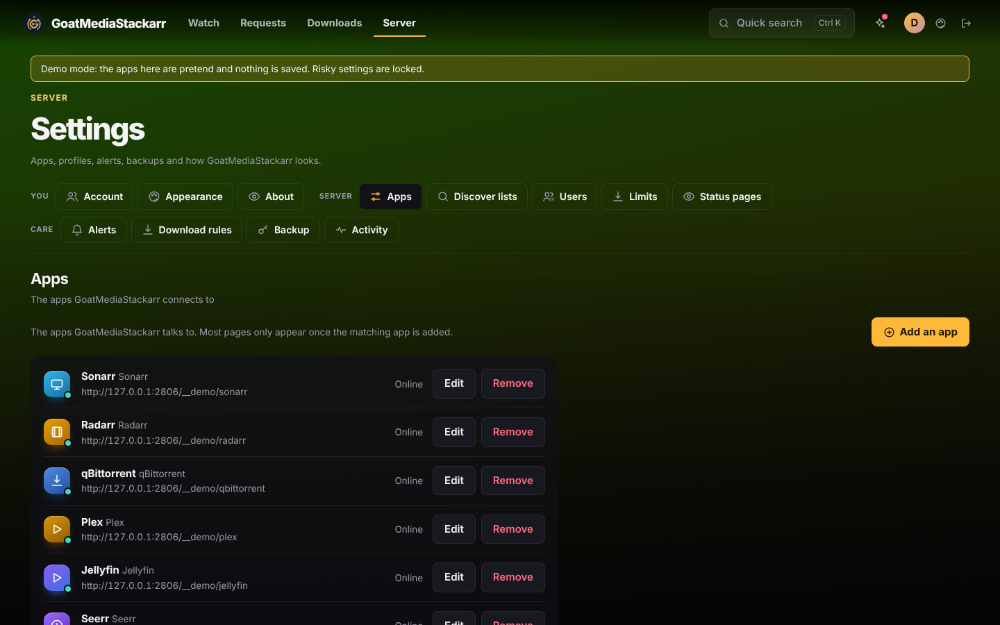 | 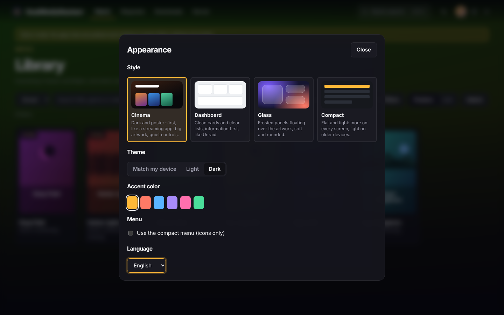 |

**Limits.** Everyone may stream 100 GB a month from Plex and Jellyfin by default (admins are never limited). At 80% they get a message, and at the limit their streams stop until the 1st. Change the default, count only streams from outside the home, or give someone their own limit under Settings → Limits. Admins can also cap the disk space a person's requests take.

## The Android app

A native app (Kotlin and Jetpack Compose), not a web page in a frame. It has the same four styles and eight colour themes (G.O.A.T. Gold, Midnight for OLED, Ember, Aurora, Forest, Paper, Glacier and Material You).

<p>
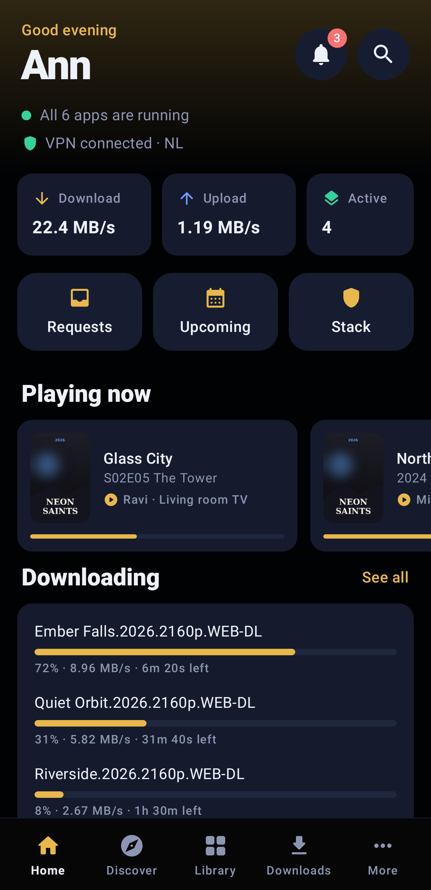
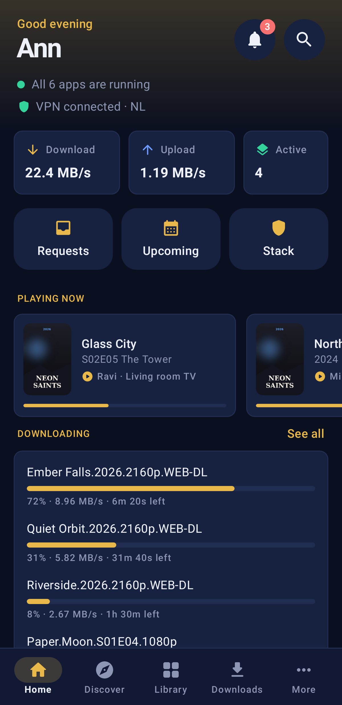
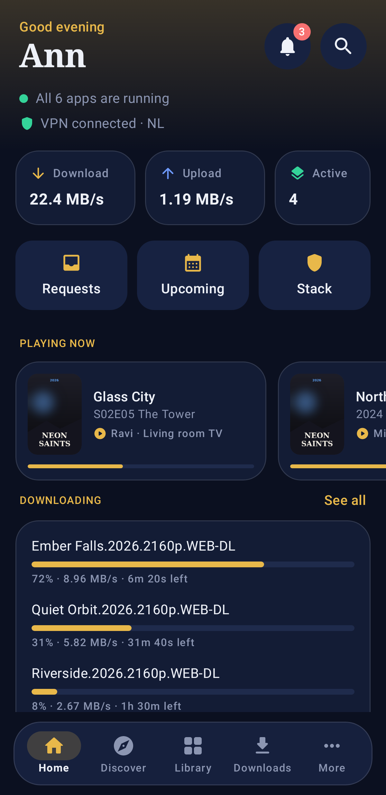
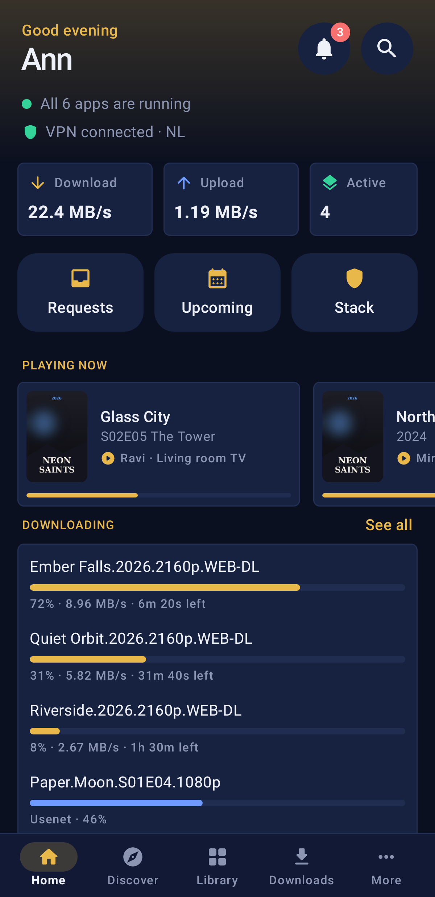
</p>
<p>
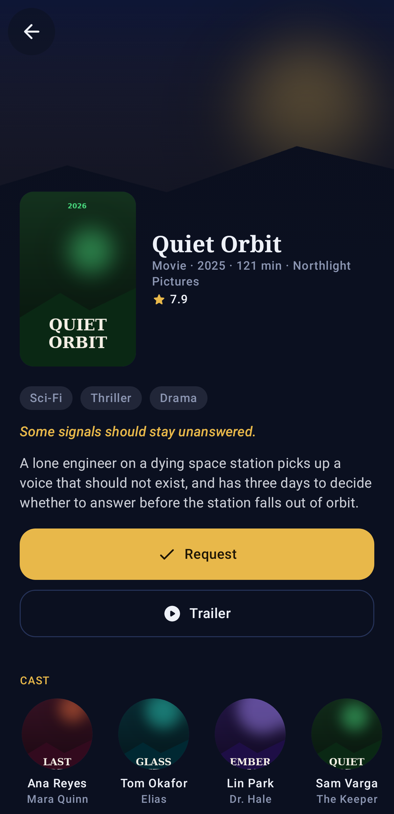
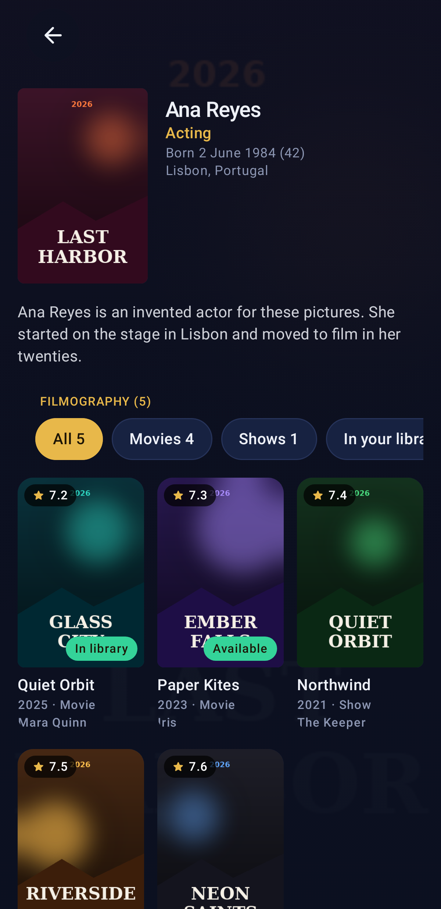
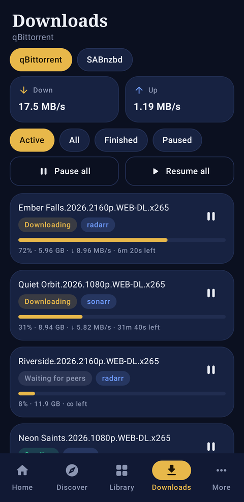
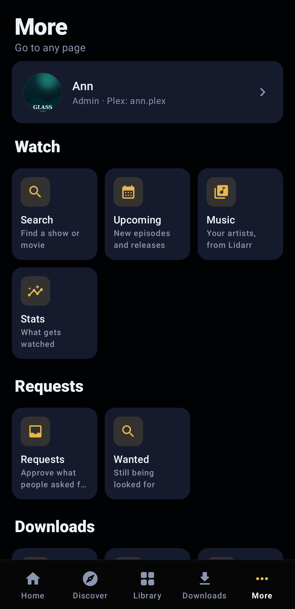
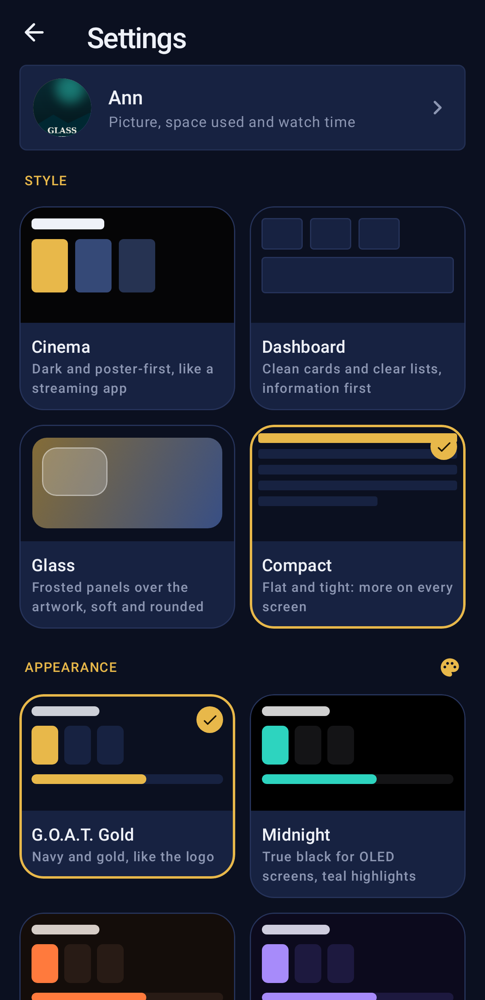
</p>

- **Home**: speeds, what is playing and downloading, what is coming, the latest requests, and whether every app and the VPN are fine. A bell with what is new for you.
- **Discover**, **Search** and **Library**, with each title's page (cast, More like this, seasons, trailer) and actors' filmographies; request through Seerr (the whole show or chosen seasons) or add straight to Sonarr or Radarr.
- **Downloads** with every client, **RSS** (tick several articles and download them at once), **Upcoming** with a calendar, **Wanted** and **Choose a release**.
- **More**: every other page in groups like the web page (Watch, Requests, Downloads, Server, You), including **Watchlist** and **What's new**.
- **In your language**: English, Hindi, Spanish, German or French (Settings → Language), and a **home-screen widget** with the download and upload speeds and what is playing.
- **Profile**: your picture, your streaming this month, the space your requests take and your watch time.
- **Notifications** that work with the app closed and without Google services: something you asked for is ready, a request was approved or declined, your streaming limit; for admins also new requests, problem reports and server problems.
- **Sign in** with your name and password (two-step codes work) or **Sign in with Plex**.

**Install:** download `goatmediastackarr.apk` from the [latest release](https://github.com/bdlnaredi/goatmediastackarr/releases/latest) on your phone and open it. Then enter the address you use in the browser, for example `192.168.1.10:2806`. Android 8 or newer; newer versions install over older ones, and the app tells you when one is out.

## What's new and updates

<p align="center">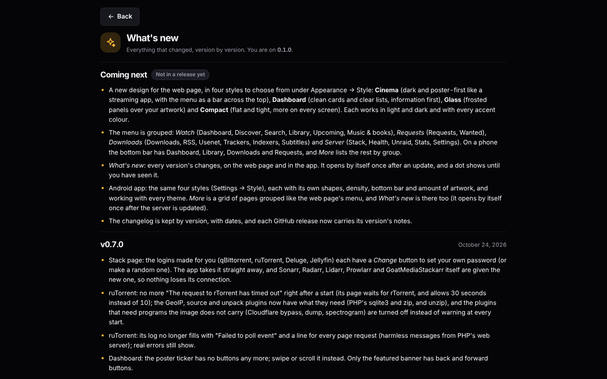</p>

- **What's new** (web page: in the menu; app: More) lists every version's changes. It opens by itself once after an update, and a dot shows until you've seen it. The same list is [CHANGELOG.md](CHANGELOG.md), kept by version with dates, and each [GitHub release](https://github.com/bdlnaredi/goatmediastackarr/releases) carries its version's notes.
- **Weekly rebuild**: every Monday GitHub rebuilds the image with the newest release of every app, runs every check, and only then publishes it as `latest` (also `weekly` and `weekly-YYYYMMDD`). Version tags such as `0.7.0` never change.
- **You choose when to update**: Unraid's Docker tab shows *update ready*; click **Update** (or let the Auto Update plugin do it). Back up App data first: a newer app can change its database so an older one can't read it. Afterwards the Stack page lists each app's version and what changed ("Sonarr 4.0.15 → 4.0.16"), and admins hear about it in the bell and on any alert channel that wants it.

## The VPN

Only the apps that need it use the VPN: by default qBittorrent, SABnzbd and Prowlarr. ruTorrent's rTorrent and Deluge follow qBittorrent, and FlareSolverr follows Prowlarr. Jellyfin streaming, Seerr, Sonarr, Radarr and the web pages keep your normal connection.

- **Kill switch**: the VPN apps are cut off from the internet before they start, and whenever the tunnel is down. They never fall back to your home connection, but can still talk to the other apps, so Sonarr can always reach qBittorrent. Their DNS goes through the tunnel too, which also gets around providers that block indexer sites.
- **Private Internet Access (PIA)** needs no file: on the Stack page choose PIA, enter your PIA username (`p1234567`) and password, pick a region or *Fastest*, and press **Save and apply**.
- **Any other provider**: put its WireGuard `.conf` (or OpenVPN `.ovpn`) file in `appdata/goatmediastackarr/vpn/`, or upload it on the Stack page, and turn the VPN on.
- **Port forwarding**: PIA's own (`VPN_PORT_FORWARD=pia`, in regions that allow it, renewed every 15 minutes) or NAT-PMP for ProtonVPN and similar (`natpmp`). The forwarded port is given to qBittorrent.
- **Leak test** on the Stack page compares the VPN apps' address with your server's own.

| Setting | Default | Meaning |
|---|---|---|
| `VPN_ENABLED` | `false` | Turn the VPN on |
| `VPN_PROVIDER` | | `pia` for Private Internet Access; empty uses your file |
| `VPN_REGION` | fastest | PIA region id, like `swiss` or `ca_toronto` |
| `VPN_TYPE` | `wireguard` | `wireguard` or `openvpn` (PIA always uses WireGuard) |
| `VPN_USER`, `VPN_PASS` | | PIA sign-in, or OpenVPN sign-in if your provider needs one |
| `VPN_APPS` | `qbittorrent,sabnzbd,prowlarr` | Which apps use the VPN |
| `VPN_DNS` | from the VPN file | DNS through the tunnel |
| `VPN_PORT_FORWARD` | `off` | `pia` or `natpmp` |
| `VPN_PF_GATEWAY` | `10.2.0.1` | NAT-PMP gateway inside the tunnel |

Settings changed on the Stack page are saved in `appdata/goatmediastackarr/goat/settings.json` and win over the template. The kill switch is tested on every change, including with a real WireGuard tunnel.

## Choosing the apps

`GOAT_ENGINES` lists the apps to run. Take out any you don't want, and add:

- **`plex`** for a built-in Plex server: map port 32400, put a claim code from [plex.tv/claim](https://plex.tv/claim) in `PLEX_CLAIM` and start within 4 minutes. Its libraries are made for you. Plex isn't shipped in the image (it isn't open source); it is downloaded from plex.tv on first start, like the official container. `PLEX_UPDATE=false` keeps the installed version. Already have a Plex server? Add it under Settings → Apps instead; both work alongside Jellyfin.
- **`tautulli`** for Plex statistics (needs Plex).
- **`flaresolverr`** when indexer sites show Cloudflare's "checking your browser" page. It is downloaded on first start with its own browser, added to Prowlarr as a proxy with the tag `flaresolverr` (tag the sites that need it), and follows Prowlarr onto the VPN. x86 only.
- **`rutorrent`** and **`deluge`** for more torrent apps next to qBittorrent (below).

Seerr works with one media server: Jellyfin when it runs, otherwise Plex. `SEERR_MEDIA_SERVER=plex` picks Plex while both run (decided on Seerr's first setup).

## ruTorrent and Deluge

**Built in.** Add `rutorrent` and/or `deluge` to `GOAT_ENGINES` and map their ports.

| | ruTorrent | Deluge |
|---|---|---|
| Its page | `http://<server>:8090` | `http://<server>:8112` |
| Sign-in | user `goat` and a password made for you | a password made for you |
| Torrent port | 50414 | 50415 |
| Settings | `appdata/goatmediastackarr/rutorrent` (your own rTorrent settings go in `rtorrent.local.rc`) | `appdata/goatmediastackarr/deluge` |

The logins are on the Stack page (*Logins made for you*), where you can change them. Sonarr, Radarr, Lidarr and Prowlarr get both as download clients after qBittorrent (used only when qBittorrent isn't available; change the priorities in their Download Clients settings to make one the main one). Finished files go to `downloads/torrents/complete`. ruTorrent's page waits for rTorrent to answer after a start, and plugins that need programs the image doesn't carry are turned off.

**Ones you already run** (in another container or on a seedbox): add them under Settings → Apps. They appear in Downloads like the built-in ones, and **Use in Sonarr/Radarr** adds them to Sonarr, Radarr and Lidarr as a download client.

## From outside your home

GoatMediaStackarr's own page (port 2806) is the way in to everything except Jellyfin, Seerr, Plex, ruTorrent and Deluge, which have their own ports. The other apps' own pages are at `/engines/<app>/` (Sonarr, Radarr, Lidarr, Prowlarr, Bazarr, qBittorrent, SABnzbd, Tautulli), for admins, signed in through GoatMediaStackarr.

- **Tailscale** (the Unraid plugin): use `http://<unraid's tailscale name>:2806` in the browser and the app; the other ports work as they are. Best for watching Jellyfin away from home.
- **Cloudflare Tunnel**: point a hostname such as `goat.example.com` at port 2806, and give Jellyfin, Seerr (and ruTorrent or Deluge, if you use their pages) their own hostnames. Enter those on the Stack page under *From outside your home* so the Open buttons use them. Cloudflare's terms don't allow streaming lots of video through a free tunnel.
- **Phone apps** for Sonarr, Radarr and the others (nzb360, LunaSea, Ruddarr…): use `https://goat.example.com/engines/sonarr` (or `/engines/radarr`…) with that app's API key from its Settings → General.

## Moving from your current setup

On the Stack page, **Bring in your current setup** copies shows, movies, artists and Prowlarr indexers from the Sonarr, Radarr, Lidarr or Prowlarr you use now. Enter its address and API key, press **Check**, say where each old folder is inside GoatMediaStackarr (for example `/tv` → `/media/tv`), then **Bring in**.

- It keeps each item's monitored state, seasons, quality profile and tags, and doesn't search or download anything. With *Also bring in your settings* (on by default) your quality profiles, custom formats, delay and release profiles and file naming come first.
- Your old apps are only read from. Running it again adds only what's new. History and download clients aren't copied; indexers with a password or cookie may need it again.

## Folders and storage

```
/media/tv            TV shows (Sonarr, Jellyfin "TV Shows")
/media/movies        Movies (Radarr, Jellyfin "Movies")
/media/music         Music (Lidarr, Jellyfin "Music")
/downloads/torrents  qBittorrent, ruTorrent and Deluge
/downloads/usenet    SABnzbd
```

**One share for everything** makes finished downloads move into the library instantly (hardlinks) instead of being copied: map `/data` to `/mnt/user/data` and set `MEDIA_DIR=/data/media` and `DOWNLOADS_DIR=/data/downloads`. Existing files are never re-owned or moved.

What is kept in `appdata/goatmediastackarr/`: each app's own folder; `goat/secrets.json` (the keys and passwords made on first start); `goat/wired.json` (what was connected on the last start); `ui/` (GoatMediaStackarr's accounts and settings); `vpn/` (your VPN file).

| Setting | Default | Meaning |
|---|---|---|
| `PUID` / `PGID` | `99` / `100` | User and group that own the files (Unraid's nobody/users) |
| `TZ` | `Etc/UTC` | Time zone |
| `UMASK` | `002` | New files are group-writable |
| `GOAT_FILEBROWSER` | `true` | File Browser: your media and downloads folders in the browser (Stack page → File Browser, admins only). `false` turns it off |
| `GOAT_DNS` | *(automatic)* | DNS servers for the apps, like `1.1.1.1,8.8.8.8`. Left empty, GoatMediaStackarr checks at every start that TMDB can be looked up and, if your network's DNS fails it, adds public servers after your own. `off` leaves DNS alone |
| `TORRENT_PORT` | `50413` | qBittorrent's incoming port (6881 is blocked by many trackers) |

## Troubleshooting

- **A connection failed on first start**: the Stack page's *Connections* says which and why. *Connect the apps again* is safe any time; failed ones are also retried at the next start.
- **Seerr: "needs a media server"**: turn on Jellyfin, or add your Plex under Settings → Apps.
- **No posters in Seerr or Discover, and `[TMDB] … ECONNRESET` in the log**: some internet providers block TMDB. Add `--dns 1.1.1.1 --dns 8.8.8.8` to the container's Extra Parameters, or set those DNS servers for the whole server.
- **"Unable to get queue from Radarr/Sonarr" after restoring a backup**: the restored app has its old API key; the next container start fixes it.
- **Tracker websites are slow through the VPN**: pick a VPN server near you, prefer WireGuard, and add sites that allow it *without the VPN*.
- **Older problems** (Seerr saying "Seerr Updated" on every visit, OpenVPN "TUNSETIFF … busy", WireGuard sending but not receiving, FlareSolverr without its browser or "version not detected", ruTorrent timing out right after a start): all fixed; update the container. [What's new](CHANGELOG.md) says in which version.

Still stuck? [Open an issue](https://github.com/bdlnaredi/goatmediastackarr/issues) with the container's log.

## Licenses

GoatMediaStackarr is GPL-3.0-or-later. It runs each app's official release unchanged, under that app's own license (see [THIRD_PARTY.md](THIRD_PARTY.md)). Sonarr, Radarr, Jellyfin and the other names belong to their projects; GoatMediaStackarr isn't affiliated with or endorsed by them.

## Development

```
cd ui && npm test                 # the web page and its server, against pretend apps
node --test test/*.test.js        # settings, wiring and the control service
sudo bash test/vpn-killswitch.sh  # the kill switch, in real network namespaces
sudo bash test/vpn-wireguard.sh   # the kill switch with a real WireGuard tunnel
node scripts/screenshots.js       # these screenshots, in demo mode (also the "Update screenshots" workflow)
```

Every change is also built for Intel/AMD and ARM and started for real: every app must answer and be connected, ruTorrent and Deluge must take a torrent, FlareSolverr must open a page, the login passwords must change, and the VPN apps must stay offline without a VPN. The Android app is built and every screen photographed in each style. Tagging a version (`v0.7.1`) publishes the image and the app, and the GitHub release gets that version's part of the changelog.

The logo is drawn by `docs/logo/make_logo.py`, which also writes the app icons.
